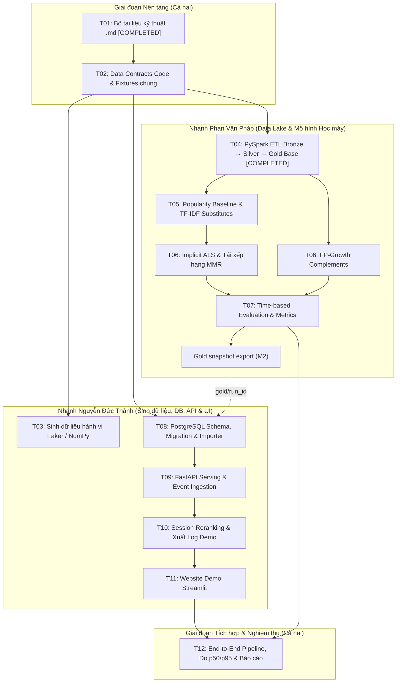

# Kế hoạch triển khai dự án Hệ thống Gợi ý Sản phẩm (PLAN.md)

Tài liệu này chi tiết hóa toàn bộ các bước triển khai kỹ thuật cho hệ thống gợi ý sản phẩm dựa trên hành vi người dùng, bám sát các tài liệu đặc tả `docs/CONVENTIONS.md`, `docs/DATA_CONTRACTS.md`, `docs/PROJECT_CHECKLIST.md` và `docs/README.md`.

---

## 1. Nguyên tắc làm việc & Phân vai
- **Vai trò Quản lý & Review (Antigravity)**: Lập kế hoạch, theo dõi tiến độ, review tài liệu và mã nguồn, kiểm tra `git diff`, xác minh kết quả kiểm thử trước và sau mỗi task, đảm bảo hợp đồng dữ liệu và API không bị vi phạm.
- **Vai trò Lập trình & Thực thi (Codex)**: Thực hiện toàn bộ các thay đổi mã nguồn và tài liệu cho từng task cụ thể theo yêu cầu.
- **Quy trình bàn giao task**:
  1. Kế hoạch được User duyệt.
  2. Giao từng task cho Codex kèm phạm vi, người phụ trách, tiêu chí hoàn thành và lệnh kiểm tra rõ ràng.
  3. Chạy lệnh kiểm tra tự động (`pytest`, `ruff`, kiểm tra file/link).
  4. Review `git diff` và output kiểm tra.
  5. Khi đạt tiêu chí mới đánh dấu hoàn thành và chuyển sang task tiếp theo.

---

## 2. Bảng Phân công Công việc 2 Người & Luồng Thực thi Song song

Dự án do **Nguyễn Đức Thành** (Thành - Vai trò A: Ingestion/Database/API/UI/Complements) và **Phan Văn Pháp** (Pháp - Vai trò B: Data Lake/PySpark ETL/Mô hình/Evaluation) cùng thực hiện.

### 2.1. Đánh giá Khối lượng Công việc (Workload Balance)
- **Nhánh Nguyễn Đức Thành (Full-stack Data App)**: Xây dựng bộ sinh hành vi Faker/NumPy, thiết kế PostgreSQL DDL/Migrations, Atomic Importer, FastAPI (7 routes, xử lý concurrency/idempotency), gợi ý theo phiên thời gian thực và Streamlit Web UI. Khối lượng tập trung vào tính rộng của hệ thống, nhiều công nghệ tích hợp (SQL, API, Frontend, Session State).
- **Nhánh Phan Văn Pháp (Big Data & Machine Learning Core)**: Xây dựng pipeline PySpark ETL (chuẩn hóa Bronze $\rightarrow$ Silver $\rightarrow$ Gold Parquet), thuật toán Popularity, TF-IDF Content-Based (Substitutes), Collaborative Filtering Implicit ALS, tái xếp hạng MMR và toàn bộ module đánh giá (Time-based split, Recall@10, NDCG@10, Diversity, Coverage). Khối lượng tập trung vào độ sâu thuật toán, tối ưu tài nguyên PySpark local và tính toán toán học.
- **Kết luận**: Khối lượng công việc tương đương 50/50, cân bằng hoàn hảo giữa **Kỹ thuật Dữ liệu lớn & Mô hình hóa (Big Data / ML)** và **Ứng dụng & Phục vụ Thời gian thực (Serving / Web App)**.

---

### 2.2. Ma trận Phân công Trách nhiệm (RACI Matrix)

| Task ID | Nội dung công việc | Người phụ trách chính | Người review | Sản phẩm bàn giao chính |
| :--- | :--- | :--- | :--- | :--- |
| **T01** | Khởi tạo Bộ Tài liệu Kỹ thuật Markdown (.md) | **Cả hai** | Antigravity | 4 tài liệu mới, 2 tài liệu cập nhật |
| **T02** | Cấu trúc Nền tảng, Data Contracts Code & Fixtures | **Cả hai** | Antigravity | Schemas Pydantic, test fixtures nhỏ |
| **T03** | Bộ Sinh Dữ liệu Hành vi Mô phỏng (Synthetic Data) | **Nguyễn Đức Thành** | Phan Văn Pháp | Bộ sinh Faker/NumPy, Bronze JSONL events |
| **T04** | Pipeline ETL PySpark: Bronze $\rightarrow$ Silver $\rightarrow$ Gold Base | **Phan Văn Pháp** | Nguyễn Đức Thành | Script ETL PySpark, Parquet sạch, ma trận tương tác |
| **T05** | Mô hình 1: Popularity Baseline & TF-IDF Substitutes | **Phan Văn Pháp** | Nguyễn Đức Thành | Model Popularity & TF-IDF, gợi ý thay thế |
| **T06** | Mô hình 2: Implicit ALS, FP-Growth & MMR Re-ranking | **Phan Văn Pháp** *(ALS, MMR, FP-Growth)* | Nguyễn Đức Thành | Model ALS, luật giỏ hàng FP-Growth, tái xếp hạng MMR |
| **T07** | Phân chia Đánh giá Thời gian & Đo lường Metrics | **Phan Văn Pháp** | Nguyễn Đức Thành | Time split 2 mốc UTC, Recall@10, NDCG@10, Diversity |
| **T08** | PostgreSQL Schema DDL, Migration & Snapshot Importer | **Nguyễn Đức Thành** | Phan Văn Pháp | SQL migrations, importer nạp Gold snapshot vào DB |
| **T09** | Phát triển Dịch vụ FastAPI (Serving & Ingestion) | **Nguyễn Đức Thành** | Phan Văn Pháp | FastAPI app 7 routes, xử lý idempotency, status codes |
| **T10** | Gợi ý Cập nhật theo Phiên & Xuất Log Bronze Demo | **Nguyễn Đức Thành** | Phan Văn Pháp | Session reranking, script xuất log PostgreSQL $\rightarrow$ Bronze |
| **T11** | Website Giao diện Demo Streamlit | **Nguyễn Đức Thành** | Phan Văn Pháp | Streamlit app 3 khối gợi ý, user switch demo |
| **T12** | Tích hợp Toàn diện (E2E), Benchmark & Bàn giao | **Cả hai** | Antigravity | Script chạy pipeline 1 lệnh, báo cáo thực nghiệm |

---

### 2.3. Sơ đồ Luồng Làm việc Song song (Parallel Workstreams)

Nhờ bộ **Data Contracts** và **Test Fixtures** thống nhất ở **T02**, hai bạn có thể phát triển song song hoàn toàn độc lập mà không bị phụ thuộc chặn tiến độ (no blocking):



---

### 2.4. Quy ước Bàn giao Giữa 2 Người
1. **Mốc M0 (Contracts & Fixtures)**: Thành bàn giao mẫu event; Pháp bàn giao mẫu catalog. Cả hai cùng kiểm tra `tests/fixtures/` chạy được offline.
2. **Mốc M1 (Dữ liệu & ETL)**: Thành bàn giao Bronze events sinh từ Faker; Pháp bàn giao script PySpark đọc Bronze xuất Silver Parquet và Gold popularity.
3. **Mốc M2 (Phục vụ & Snapshot)**: Pháp bàn giao cấu trúc file Gold snapshot; Thành xây dựng Importer nạp snapshot vào PostgreSQL và kích hoạt nguyên tử (atomic transaction).
4. **Mốc M3 (Mô hình & API)**: Pháp bàn giao danh sách cá nhân hóa (ALS + MMR), thay thế (TF-IDF) và luật giỏ hàng (FP-Growth) trong Gold snapshot; Thành hoàn thiện 3 endpoint gợi ý trên FastAPI.
5. **Mốc M4 (Tương tác Phiên & UI)**: Thành tích hợp gợi ý theo phiên trên API và giao diện Streamlit; Pháp hỗ trợ logic trọng số tương tác phiên.
6. **Mốc M5 (Tích hợp & Báo cáo)**: Cả hai chạy script `run_pipeline.py` từ checkout sạch, đo đạc thông số và hoàn thiện slide/báo cáo.

---

## 3. Danh sách các Task chi tiết

### [T01] [COMPLETED] Khởi tạo Bộ Tài liệu Kỹ thuật Markdown (.md) Hoàn chỉnh
- **Người phụ trách**: Cả hai (Nguyễn Đức Thành & Phan Văn Pháp)
- **Người review**: Antigravity
- **Mục tiêu**: Xây dựng đầy đủ các file tài liệu Markdown nền tảng ở thư mục gốc và thư mục `docs/`.
- **Phạm vi**:
  - `README.md` (Thư mục gốc repo).
  - `docs/ARCHITECTURE.md`.
  - `docs/DATA_CONTRACTS.md`.
  - `docs/EXPERIMENT_PLAN.md`.
  - Đồng bộ `docs/README.md`, `docs/DATA_CONTRACTS.md`, `docs/PROJECT_CHECKLIST.md`.
- **Tiêu chí hoàn thành (DoD)**:
  - 100% file `.md` tồn tại, không có placeholder chưa hoàn thiện.
  - Toàn bộ liên kết relative markdown đều hợp lệ (112/112 links).
- **Lệnh kiểm tra**:
  ```powershell
  python -c "import os, sys; files=['README.md', 'docs/ARCHITECTURE.md', 'docs/DATA_CONTRACTS.md', 'docs/EXPERIMENT_PLAN.md', 'docs/TEAMWORK.md', 'docs/PROJECT_CHECKLIST.md']; missing=[f for f in files if not os.path.isfile(f)]; sys.exit(f'Missing: {missing}') if missing else print('All markdown files exist!')"
  ```

---

### [T02] [COMPLETED] Cấu trúc Nền tảng, Data Contracts Code & Test Fixtures
- **Người phụ trách**: Cả hai (Hợp đồng chung)
- **Người review**: Antigravity
- **Đầu vào**: Đặc tả kỹ thuật từ `docs/DATA_CONTRACTS.md`.
- **Đầu ra bàn giao**: Schemas Pydantic dùng chung cho cả backend lẫn pipeline, và bộ dữ liệu test offline.
- **Mục tiêu**: Định nghĩa các data model, schema chuẩn bằng code Python (Pydantic / Dataclass) cho Bronze, Silver, Gold và API theo `docs/DATA_CONTRACTS.md`, thiết lập cấu hình môi trường và bộ fixtures nhỏ để phục vụ kiểm thử offline.
- **Phạm vi**:
  - `src/recommender/config.py`: Đọc cấu hình từ biến môi trường/`.env` (`DATA_LAKE_DIR`, `DATABASE_URL`, `API_BASE_URL`, `RANDOM_SEED`).
  - `src/recommender/schemas.py`: Định nghĩa schemas cho Product, Event, Gold tables, API payloads & responses.
  - `tests/fixtures/products.jsonl`: Bộ catalog mẫu ~20 sản phẩm thuộc 3-4 danh mục khác nhau.
  - `tests/fixtures/events.jsonl`: Bộ sự kiện mẫu ~50 events (view, click, add_to_cart có cart_id).
  - `tests/test_contracts.py`: Test kiểm tra tính hợp lệ của schema, parse JSONL, validation UTC và cart_id.
- **Tiêu chí hoàn thành (DoD)**:
  - Ràng buộc logic (như `add_to_cart` bắt buộc có `cart_id`) được kiểm tra tự động bằng validation.
  - Fixtures hợp lệ và parse thành công vào schemas.
  - Code đạt chuẩn Ruff format và lint không có lỗi.
- **Lệnh kiểm tra**:
  ```powershell
  python -m pytest tests/test_contracts.py -v
  python -m ruff check src tests
  ```

---

### [T03] Thu thập Catalog Best Buy Open Data Set (1.000 Sản phẩm) & Bộ Sinh Dữ liệu Hành vi
- **Người phụ trách**: Nguyễn Đức Thành
- **Người review**: Phan Văn Pháp
- **Đầu vào**: Best Buy Open Data Set (`BestBuyAPIs/open-data-set`), cấu hình seed từ T02.
- **Đầu ra bàn giao**: Dữ liệu Bronze catalog (1.000 sản phẩm thật), Bronze events (hàng chục/trăm nghìn dòng) có quy luật và manifest để Pháp bắt đầu viết ETL PySpark.
- **Mục tiêu**: 
  - Xây dựng module `src/recommender/ingestion/catalog.py` tải/trích xuất và lọc đúng **1.000 sản phẩm công nghệ thật** từ Best Buy Open Data Set thuộc các ngành hàng tiêu biểu (TV, Laptops, Audio, Cell Phones, Cameras, Video Games, Appliances...), chuẩn hóa schema `Product`, lưu file seed `data/raw/products_bestbuy_1000.json` và xuất Bronze `data/bronze/products/products.jsonl`.
  - Xây dựng module `src/recommender/ingestion/synthetic.py` sinh dữ liệu tương tác người dùng có quy luật (nhóm sở thích danh mục, độ lệch phổ biến, chuỗi hành vi theo phiên, giỏ hàng nhiều sản phẩm cho FP-Growth) sử dụng Faker/NumPy dựa trên catalog 1.000 sản phẩm.
- **Phạm vi**:
  - `src/recommender/ingestion/catalog.py`:
    - CLI/hàm: tải từ GitHub `BestBuyAPIs/open-data-set` hoặc đọc từ cache/seed `data/raw/products_bestbuy_1000.json`, lọc chọn 1.000 sản phẩm sạch nhất thuộc ~10-12 ngành hàng chính.
    - Chuẩn hóa schema `Product`: gán ID chuẩn `bestbuy:<sku>`, format `image_url` (hỗ trợ HTTPS), trích xuất tags từ `manufacturer`, `model`, subcategory.
    - Ghi file JSONL ra `data/bronze/products/` và tạo file `manifest.json`.
  - `src/recommender/ingestion/synthetic.py`:
    - CLI/hàm nhận: `catalog_path`, `n_users`, `n_sessions`, `n_events`, `output_dir`, `seed`.
    - Sinh `event_id` (UUID), `user_id`, `session_id`, `product_id`, `event_type`, `event_at`, `source="synthetic"`, `cart_id`.
    - Tạo phân bố sở thích danh mục theo nhóm người dùng và giỏ hàng chứa nhiều item đi kèm (cho FP-Growth).
    - Ghi JSONL theo chunk vào `data/bronze/events/` và tạo `manifest.json`.
  - `tests/test_ingestion.py`: Test tải/chuẩn hóa catalog, kiểm tra quy mô 1.000 sản phẩm, test tính duy nhất của `event_id`, tính toàn vẹn khóa ngoại tham chiếu catalog, quy tắc `cart_id`, tính tái lập 100% khi cùng seed.
- **Tiêu chí hoàn thành (DoD)**:
  - Xuất thành công catalog 1.000 sản phẩm chuẩn schema `Product`, 100% thuộc tính hợp lệ.
  - Sinh thành công tập Bronze events mẫu tương ứng không bị lỗi bộ nhớ.
  - Cùng một seed luôn sinh ra đúng từng byte/bản ghi cho cả catalog và events.
  - 100% `product_id` trong events đều tồn tại trong catalog sinh ra.
  - 100% test trong `tests/test_ingestion.py` pass và ruff lint sạch sẽ.
- **Lệnh kiểm tra**:
  ```powershell
  python -m pytest tests/test_ingestion.py -v
  python -m recommender.ingestion.catalog --limit 1000 --output data/bronze/products/products.jsonl --seed 42
  python -m recommender.ingestion.synthetic --catalog data/bronze/products/products.jsonl --output data/bronze/events --events 500 --seed 42
  ```

---

### [T04] [COMPLETED] Pipeline ETL PySpark: Bronze $\rightarrow$ Silver $\rightarrow$ Gold Base
- **Bằng chứng thực thi 16/11/2026**: `python -m recommender.pipeline.etl` công bố Silver `ds-146a72bc3421240b42c94a87` (1.000 sản phẩm, 100.000 events sinh theo 1.000 profiles của `main`, 0 bản ghi bị loại) trong ~25 giây. Chỉ đọc JSONL đã có manifest và checksum khớp, gồm cả micro-batch Kafka. Validation từng dòng dùng chính `Product`/`Event` Pydantic (UDF), dedup/FK/chủ sở hữu session–cart chạy native Spark; conflict chặn phát hành. Gold base ở `pipeline/gold.py`. `tests/test_etl.py`: 8 pass (kể cả đầu vào rỗng, batch dở dang và batch Kafka chưa công bố/bị sửa).
- **Người phụ trách**: Phan Văn Pháp
- **Người review**: Nguyễn Đức Thành
- **Đầu vào**: Dữ liệu Bronze từ T02/T03.
- **Đầu ra bàn giao**: Bảng Parquet Silver sạch và ma trận tương tác người dùng có trọng số (Gold base).
- **Mục tiêu**: Chuẩn hóa dữ liệu thô sang Parquet Silver và tổng hợp bảng tương tác có trọng số cho Gold.
- **Phạm vi**:
  - `src/recommender/pipeline/etl.py`:
    - Đọc Bronze JSONL catalog & events.
    - Khử trùng sự kiện theo `event_id` (loại bỏ duplicate, cảnh báo conflict nếu cùng ID khác payload).
    - Chuẩn hóa timestamp ISO 8601 UTC.
    - Kiểm tra `product_id` tham chiếu catalog, kiểm tra `cart_id` của `add_to_cart`.
    - Ghi `data/silver/products/` và `data/silver/events/` định dạng Parquet.
    - Tạo Gold base: Tổng hợp trọng số tương tác (`view=1`, `click=2`, `add_to_cart=4`) theo cặp `(user_id, product_id)`.
    - Trích xuất danh sách giỏ hàng duy nhất (`cart_id`, `[product_ids]`) cho FP-Growth.
  - `tests/test_etl.py`: Test Spark ETL với fixture offline (không phụ thuộc cluster), kiểm tra schema Parquet và logic cộng dồn trọng số.
- **Tiêu chí hoàn thành (DoD)**:
  - Pipeline chạy thành công trên PySpark local mode.
  - Silver Parquet có schema chuẩn, loại bỏ các bản ghi không hợp lệ và ghi log số lượng bị loại theo từng lý do.
  - Ma trận tương tác Gold tính đúng trọng số tương tác.
- **Lệnh kiểm tra**:
  ```powershell
  python -m pytest tests/test_etl.py -v
  ```

---

### [T05] [COMPLETED] Mô hình Xếp hạng 1: Popularity Baseline & TF-IDF Content-Based (Substitutes)
- **Bằng chứng thực thi 16/11/2026**: Snapshot có 200 dòng `popular`, 82.336 dòng `substitute` cho 1.000 context, không có dòng khác danh mục hoặc trùng sản phẩm gốc; vocabulary TF-IDF 4.985 token, 0 vector rỗng. `tests/test_ranking_tfidf.py`: 6 pass.
- **Người phụ trách**: Phan Văn Pháp
- **Người review**: Nguyễn Đức Thành
- **Đầu vào**: Silver catalog và Gold interactions từ T04.
- **Đầu ra bàn giao**: Output gợi ý Popularity (fallback) và Substitutes cho API của Thành.
- **Mục tiêu**: Xây dựng thuật toán tính độ phổ biến toàn cục (làm fallback và baseline) và TF-IDF để tìm sản phẩm thay thế cùng danh mục.
- **Phạm vi**:
  - `src/recommender/ranking/popularity.py`:
    - Tính điểm phổ biến từ Gold interaction weights.
    - Sắp xếp điểm giảm dần, tie-break ổn định theo `product_id`.
    - Hỗ trợ loại bỏ các item người dùng đã tương tác (`seen_items`).
  - `src/recommender/ranking/tfidf.py`:
    - Trích xuất đặc trưng văn bản từ `name`, `category_id`, `description`.
    - Xây dựng ma trận TF-IDF và tính cosine similarity giữa các sản phẩm.
    - Xây dựng hồ sơ người dùng (User Content Profile) từ lịch sử tương tác có trọng số.
  - `src/recommender/ranking/substitutes.py`:
    - Gợi ý sản phẩm thay thế: Lọc các sản phẩm cùng `category_id`, sắp xếp theo cosine similarity, loại bỏ chính sản phẩm đang xem.
  - `tests/test_ranking_tfidf.py`: Test tính chính xác của popularity ranking và cosine similarity trên catalog fixture.
- **Tiêu chí hoàn thành (DoD)**:
  - Popularity trả về danh sách có thứ tự xác định, tie-break nhất quán.
  - Substitutes chỉ trả về sản phẩm cùng danh mục và không chứa sản phẩm gốc.
  - Output tuân thủ format Gold recommendation items (`run_id`, `kind`, `context_id`, `product_id`, `rank`, `score`, `method`).
- **Lệnh kiểm tra**:
  ```powershell
  python -m pytest tests/test_ranking_tfidf.py -v
  ```

---

### [T06] [COMPLETED] Mô hình Xếp hạng 2: Implicit ALS, FP-Growth (Complements) & MMR Re-ranking
- **Bằng chứng thực thi 16/11/2026**: ALS `rank=16, regParam=0.1, alpha=1` sinh 200.000 dòng personalized cho 1.000 user, 0 dòng trùng `seen_products`; model tải lại được cùng ánh xạ ID. FP-Growth fit 4.960 giỏ ≥2 món (loại 14 giỏ một món), xuất 655 luật đã tính lại support/confidence/lift theo từng consequent. `tests/test_ranking_advanced.py`: 9 pass (kể cả tải lại ALS cho cùng top-K).
- **Người phụ trách**: Phan Văn Pháp *(Implicit ALS, MMR & FP-Growth Complements — thống nhất với Vai trò B trong `docs/PROJECT_CHECKLIST.md`)*
- **Người review**: Nguyễn Đức Thành
- **Đầu vào**: Ma trận tương tác Gold và danh sách giỏ hàng từ T04.
- **Đầu ra bàn giao**: Bộ luật mua kèm `association_rules` và top-K cá nhân hóa `recommendation_items`.
- **Mục tiêu**: Xây dựng mô hình Collaborative Filtering (PySpark ALS), khai phá tập phổ biến giỏ hàng (FP-Growth) và thuật toán tái xếp hạng đa dạng hóa (MMR).
- **Phạm vi**:
  - `src/recommender/ranking/als.py` *(Pháp)*:
    - Ánh xạ chuỗi `user_id`, `product_id` sang số nguyên 32-bit và lưu bảng tra cứu ánh xạ.
    - Huấn luyện PySpark ALS với `implicitPrefs=True`.
    - Dự đoán top-K cho người dùng, lọc bỏ các sản phẩm đã tương tác trong snapshot, fallback về Popularity khi user mới hoặc thiếu ứng viên.
  - `src/recommender/ranking/fpgrowth.py` *(Pháp)*:
    - Huấn luyện FP-Growth trên tập giỏ hàng (`cart_id`, `product_ids`).
    - Trích xuất association rules (`antecedent_ids`, `consequent_id`, `support`, `confidence`, `lift`).
    - Logic truy vấn luật: Chọn luật có vế trái nằm trong giỏ, ưu tiên `confidence` cao nhất -> `lift` cao nhất -> sắp theo `product_id`. Loại bỏ các item đã có trong giỏ.
  - `src/recommender/ranking/mmr.py` *(Pháp)*:
    - Tái xếp hạng tập ứng viên bằng Maximal Marginal Relevance với tham số $\lambda$.
  - `tests/test_ranking_advanced.py`: Test huấn luyện, ánh xạ ID, truy vấn luật giỏ hàng và re-ranking MMR.
- **Tiêu chí hoàn thành (DoD)**:
  - Model ALS sinh được top-K cá nhân hóa và chuyển đổi ngược lại ID chuỗi chính xác.
  - FP-Growth tạo ra các luật hợp lệ, truy vấn trả về sản phẩm bổ sung chính xác và không bao giờ gợi ý lại món đã có trong giỏ.
  - MMR tăng tính đa dạng danh mục của top-K so với danh sách thô.
- **Lệnh kiểm tra**:
  ```powershell
  python -m pytest tests/test_ranking_advanced.py -v
  ```

---

### [T07] [COMPLETED] Phân chia Đánh giá theo Thời gian & Tính toán Metric Đánh giá
- **Bằng chứng thực thi 16/11/2026**: Split train/validation/test = 62.151/18.671/19.175 events, purge 1 giỏ qua biên, bốn bất biến chống rò rỉ đạt. Test (508 user): Recall@10 Popularity 0,0838, TF-IDF 0,0531, ALS 0,2764, ALS+MMR 0,2764 (`lambda=1.0` được chọn trên validation); FP-Growth Hit@10 0,806. Kết quả ở `data/gold/<run_id>/evaluation/` và [docs/README.md](docs/README.md#33-etl-mô-hình-đánh-giá-và-gold-snapshot-t04t07). `tests/test_evaluation.py` (khớp fixture tính tay 0,919720789 và ILD 2/3) + `tests/test_snapshot.py`: 7 pass; `tests/`: 406 pass (gồm test users/streaming của `main`); Ruff check/format pass.
- **Người phụ trách**: Phan Văn Pháp
- **Người review**: Nguyễn Đức Thành
- **Đầu vào**: Dữ liệu Silver và các mô hình ranking từ T05, T06.
- **Đầu ra bàn giao**: Bảng tổng hợp số liệu thực nghiệm (Recall@10, NDCG@10, Diversity, Coverage) phục vụ báo cáo.
- **Mục tiêu**: Thiết lập cơ chế chia train/val/test theo 2 mốc thời gian UTC (chống rò rỉ dữ liệu) và tính toán Recall@10, NDCG@10, intra-list diversity, catalog coverage.
- **Phạm vi**:
  - `src/recommender/evaluation/split.py`: Chia tập sự kiện theo mốc `split_val_time` và `split_test_time`. Đảm bảo các giỏ hàng không bị xé lẻ qua mốc thời gian.
  - `src/recommender/evaluation/metrics.py`:
    - Tính Recall@K và NDCG@K với nhãn relevance nhị phân từ click / add_to_cart trong tương lai.
    - Tính Intra-List Diversity (dựa trên khoảng cách cosine đặc trưng nội dung) và Catalog Coverage (tỷ lệ sản phẩm được gợi ý ít nhất một lần).
  - `src/recommender/evaluation/benchmark.py`: So sánh 4 phương án (Popularity, TF-IDF, Implicit ALS, ALS + MMR), xuất kết quả ra bảng JSON/CSV.
  - `tests/test_evaluation.py`: Test đối chiếu kết quả Recall@10 và NDCG@10 với kết quả tính tay trong test fixture.
  - `src/recommender/pipeline/snapshot.py` *(bổ sung, Vai trò B theo `docs/PROJECT_CHECKLIST.md`)*: Fit lại cấu hình đã khóa trên toàn bộ dữ liệu, xuất Gold snapshot `gold/<run_id>/` (bốn bảng phục vụ, interactions, baskets, model, ánh xạ ID, evaluation và `manifest.json`) làm đầu vào cho importer T08 (mốc M2).
  - `tests/test_snapshot.py`: Kiểm tra bảng Gold theo hợp đồng, checksum manifest, tải lại ALS và chạy lại cùng run là no-op.
- **Tiêu chí hoàn thành (DoD)**:
  - Hàm tính metric khớp 100% với số liệu tính tay trong test fixture.
  - Không có hiện tượng rò rỉ dữ liệu tương lai vào tập huấn luyện.
- **Lệnh kiểm tra**:
  ```powershell
  python -m pytest tests/test_evaluation.py -v
  ```

---

### [T08] Thiết kế PostgreSQL Schema, Migration & Snapshot Importer
- **Người phụ trách**: Nguyễn Đức Thành
- **Người review**: Phan Văn Pháp
- **Đầu vào**: Cấu trúc bảng Gold từ T04, T05, T06 và đặc tả `docs/DATA_CONTRACTS.md`.
- **Đầu ra bàn giao**: Cơ sở dữ liệu PostgreSQL sẵn sàng và script import atomic snapshot phục vụ API.
- **Mục tiêu**: Xây dựng cơ sở dữ liệu PostgreSQL cho catalog, events và snapshot phục vụ gợi ý, cùng công cụ import nguyên tử (atomic transaction) từ Gold vào PostgreSQL.
- **Phạm vi**:
  - `src/recommender/api/db.py`: Quản lý kết nối PostgreSQL (psycopg3).
  - `src/recommender/api/migrations/001_initial_schema.sql`:
    - Bảng `products`, `events`, `batch_runs`, `serving_state`, `recommendation_items`, `seen_products`, `association_rules`.
  - `src/recommender/pipeline/importer.py`: Đọc Gold snapshot Parquet, nạp vào PostgreSQL bằng transaction, cập nhật `serving_state` nguyên tử để API chuyển đổi tức thì không downtime.
  - `tests/test_importer.py`: Test migration và kiểm tra tính nguyên tử (rollback khi file Gold bị lỗi/thiếu bảng).
- **Tiêu chí hoàn thành (DoD)**:
  - Migration tạo đầy đủ các bảng, ràng buộc khóa ngoại và index.
  - Importer nạp snapshot trơn tru và rollback hoàn toàn nếu có lỗi.
- **Lệnh kiểm tra**:
  ```powershell
  python -m pytest tests/test_importer.py -v
  ```

---

### [T09] Phát triển Dịch vụ FastAPI (Serving & Event Ingestion)
- **Người phụ trách**: Nguyễn Đức Thành
- **Người review**: Phan Văn Pháp
- **Đầu vào**: Database PostgreSQL đã migrate và snapshot từ T08.
- **Đầu ra bàn giao**: Backend REST API hoàn chỉnh cho Streamlit UI kết nối.
- **Mục tiêu**: Xây dựng API v1 theo đúng hợp đồng trong `docs/DATA_CONTRACTS.md`.
- **Phạm vi**:
  - `src/recommender/api/main.py`: Khởi tạo FastAPI app, middleware, exception handler.
  - `src/recommender/api/routes/products.py`: `GET /health`, `GET /api/v1/products`, `GET /api/v1/products/{product_id}`.
  - `src/recommender/api/routes/events.py`: `POST /api/v1/events` (Idempotency: 201 created, 200 duplicate, 409 conflict, 404 missing product, 422 schema error).
  - `src/recommender/api/routes/recommendations.py`:
    - `GET /api/v1/recommendations/personalized`: Tham số `user_id`, `limit`, fallback Popularity, loại bỏ `seen_products`.
    - `GET /api/v1/recommendations/substitutes`: Tham số `product_id`, `limit`.
    - `POST /api/v1/recommendations/complements`: Body `{"product_ids":[...], "limit": 10}`.
    - Trả về `503` nếu chưa có active snapshot trong `serving_state`.
  - `tests/test_api.py`: Test đầy đủ tất cả status code (200, 201, 404, 409, 422, 503) bằng FastAPI `TestClient`.
- **Tiêu chí hoàn thành (DoD)**:
  - 100% endpoint tuân thủ bảng hợp đồng API v1.
  - Xử lý concurrency và idempotency của `POST /events` chuẩn xác.
- **Lệnh kiểm tra**:
  ```powershell
  python -m pytest tests/test_api.py -v
  ```

---

### [T10] Luồng Gợi ý Cập nhật theo Phiên (Session-based Reranking) & Xuất Log Bronze
- **Người phụ trách**: Nguyễn Đức Thành
- **Người review**: Phan Văn Pháp
- **Đầu vào**: API events và PostgreSQL từ T08, T09.
- **Đầu ra bàn giao**: Khả năng cập nhật gợi ý thời gian thực theo phiên và công cụ xuất log demo về Data Lake.
- **Mục tiêu**: Xử lý tín hiệu thời gian thực từ các click trong phiên để cập nhật top-K gợi ý ngay lập tức, và công cụ trích xuất demo events từ PostgreSQL sang Bronze.
- **Phạm vi**:
  - `src/recommender/ranking/session.py`:
    - Đọc các tương tác gần nhất trong phiên (`session_id`) trực tiếp từ PostgreSQL.
    - Trọng số tương tác phiên: `add_to_cart` > `click` > `view`.
    - Lấy các sản phẩm thay thế/tương tự của các sản phẩm vừa tương tác để làm ứng viên mới, kết hợp điểm với batch personalized score.
  - Cập nhật `GET /api/v1/recommendations/personalized`: Bổ sung tham số tùy chọn `session_id`. Nếu có `session_id`, áp dụng session reranking.
  - `src/recommender/pipeline/export_events.py`: Trích xuất các sự kiện demo trong DB sang Bronze JSONL (`data/bronze/events/events_demo_<timestamp>.jsonl`) để sẵn sàng cho chu kỳ batch tiếp theo.
  - `tests/test_session_and_export.py`: Test kiểm tra gợi ý thay đổi ngay sau khi ghi nhận click mới cùng session.
- **Tiêu chí hoàn thành (DoD)**:
  - Khi một session click vào danh mục mới, top-K gợi ý cá nhân hóa phản ánh danh mục đó ngay trong request tiếp theo mà không cần chạy lại batch toàn bộ.
  - Job xuất log Bronze tạo file JSONL hoàn chỉnh, đúng schema, có manifest.
- **Lệnh kiểm tra**:
  ```powershell
  python -m pytest tests/test_session_and_export.py -v
  ```

---

### [T11] Website Giao diện Demo Streamlit
- **Người phụ trách**: Nguyễn Đức Thành
- **Người review**: Phan Văn Pháp
- **Đầu vào**: API endpoints từ T09, T10.
- **Đầu ra bàn giao**: Giao diện website mua sắm hoàn chỉnh có đầy đủ 3 nhóm gợi ý để báo cáo và bảo vệ đề tài.
- **Mục tiêu**: Xây dựng giao diện web mua sắm trực quan kết nối với FastAPI, hiển thị 3 nhóm gợi ý và cho phép demo kịch bản tương tác người dùng.
- **Phạm vi**:
  - `src/recommender/ui/app.py`: Giao diện chính với Streamlit.
  - `src/recommender/ui/components/`:
    - Quản lý State: Lưu giữ `user_id`, `session_id`, `cart_id` ổn định.
    - Header: Cho phép chọn User demo (User cũ có lịch sử để test ALS vs User mới tinh để test Cold-Start / Fallback).
    - Trang chủ: Hiển thị catalog sản phẩm và khối **Dành cho bạn** (có nút gạt so sánh giữa Batch thuần túy và Session-based cập nhật thời gian thực).
    - Trang chi tiết sản phẩm: Xem chi tiết sản phẩm, nút "Thêm vào giỏ", tự động ghi nhận event `view`/`click` qua API, hiển thị khối **Sản phẩm thay thế**.
    - Trang giỏ hàng: Danh sách món trong giỏ, nút tạo giỏ mới, hiển thị khối **Thường thêm cùng** từ API complements.
  - `tests/test_ui.py`: Smoke test khởi tạo và kiểm tra module UI không bị syntax/import error.
- **Tiêu chí hoàn thành (DoD)**:
  - Giao diện thao tác mượt mà, gọi đúng các API endpoint.
  - Thao tác trên giao diện ghi nhận đúng event vào PostgreSQL.
  - Cả 3 khối gợi ý hiển thị đúng nội dung theo ngữ cảnh người dùng.
- **Lệnh kiểm tra**:
  ```powershell
  python -m pytest tests/test_ui.py -v
  ```

---

### [T12] Tích hợp Toàn diện (End-to-End Pipeline) & Đo đạc Hiệu năng
- **Người phụ trách**: Cả hai (Nguyễn Đức Thành & Phan Văn Pháp)
- **Người review**: Antigravity
- **Đầu vào**: Toàn bộ các module từ T02 đến T11.
- **Đầu ra bàn giao**: Script tự động hóa chạy trọn vẹn dự án, số liệu đo độ trễ p50/p95 và báo cáo hoàn chỉnh.
- **Mục tiêu**: Xây dựng kịch bản tích hợp từ A -> Z (Single-command runner) và bộ script đo đạc hiệu năng (latency p50/p95, batch runtime, throughput).
- **Phạm vi**:
  - `scripts/run_pipeline.py`: Chạy toàn bộ chu trình tự động: Ingestion -> ETL -> Train Models -> Evaluate -> Export Gold -> Import DB -> Health check.
  - `scripts/benchmark.py`: Đo đạc độ trễ API p50/p95 cho các endpoint gợi ý và nhận event.
  - Cập nhật `README.md` & `docs/README.md`: Hướng dẫn đầy đủ các bước cài đặt và chạy từ checkout sạch.
- **Tiêu chí hoàn thành (DoD)**:
  - Script `run_pipeline.py` chạy thành công từ đầu đến cuối không lỗi.
  - Toàn bộ test suite của dự án đạt 100% pass (`pytest`).
  - Toàn bộ code tuân thủ linting và format chuẩn (`ruff check .`, `ruff format --check .`).
- **Lệnh kiểm tra**:
  ```powershell
  python -m pytest -v
  python -m ruff check .
  python -m ruff format --check .
  python scripts/run_pipeline.py --demo
  ```

---

## 4. Lệnh Giao Task Tiếp Theo Cho Codex (Task T02)

Khi User duyệt kế hoạch phân chia chi tiết, lệnh thực thi giao **Task T02** (tạo cấu trúc nền tảng, schemas pydantic và fixtures chung) từ thư mục gốc của repository cho Codex:

```powershell
$null | codex exec --dangerously-bypass-approvals-and-sandbox "Đọc PLAN.md và docs/DATA_CONTRACTS.md. Hãy thực hiện hoàn chỉnh Task T02: Tạo src/recommender/config.py, src/recommender/schemas.py, tests/fixtures/products.jsonl, tests/fixtures/events.jsonl và tests/test_contracts.py. Đảm bảo toàn bộ tiêu chí hoàn thành của T02 được đáp ứng và lệnh 'python -m pytest tests/test_contracts.py -v' cùng 'python -m ruff check src tests' chạy thành công."
```
