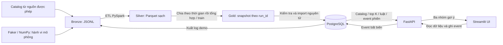

# Hệ thống gợi ý sản phẩm dựa trên hành vi người dùng

Tiểu luận Dữ liệu lớn của **Nhóm 1 — Nguyễn Đức Thành và Phan Văn Pháp**. Dự án xây dựng một website mua sắm demo sử dụng lượt xem, click và thêm giỏ để gợi ý sản phẩm. Dữ liệu đi qua Data Lake ba lớp, được xử lý bằng PySpark và được phục vụ bằng PostgreSQL, FastAPI, Streamlit.

## Phạm vi và trạng thái

| Vị trí trên website | Kết quả | Phương pháp |
| --- | --- | --- |
| Trang chủ | Dành cho bạn | Popularity làm baseline/fallback; so sánh TF-IDF theo hồ sơ user, Implicit ALS và ALS + MMR. |
| Trang chi tiết | Sản phẩm thay thế | TF-IDF và cosine similarity, chỉ trong cùng `category_id`, loại sản phẩm gốc. |
| Giỏ hàng | Thường thêm cùng | FP-Growth trên tập sản phẩm của giỏ; lọc sản phẩm đã có và áp dụng quy tắc tương thích khi có đủ thông số. |

Mô hình dài hạn được cập nhật theo batch. Trong một phiên, API kết hợp kết quả batch với các tương tác vừa commit để thay đổi thứ tự gợi ý mà không train lại ALS. Trọng số v1 cố định: `view=1`, `click=2`, `add_to_cart=4`.

**Trạng thái trước tích hợp 25/11/2026.** Phần ứng dụng của Thành đã có migration PostgreSQL, importer Gold nguyên tử, FP-Growth, đủ 7 route FastAPI, gợi ý phiên, exporter và Streamlit. Toàn bộ 450 tests pass với PostgreSQL/Spark thật; browser demo và benchmark 400 request đã chạy bằng fixture 5 sản phẩm. Catalog/Bronze có 1.000 sản phẩm và khoảng 120 nghìn events; ETL/Gold/model/metric thật của Pháp và nghiệm thu trên máy thứ hai còn chờ. [Chạy demo ngay](docs/DEMO.md) · [Báo cáo phần Thành](docs/THANH_REPORT.md) · [ERD](docs/DATABASE.md).

**Tích hợp PR #1 ngày 27/11/2026:** nhánh `codex/integrate-ml-pipeline` nối ETL/model/publisher của Pháp với validator/importer/API/UI của Thành. Hướng dẫn và phạm vi kiểm tra ở [INTEGRATION.md](docs/INTEGRATION.md). Publisher chạy bằng `python -m recommender.pipeline.publish_snapshot`; module snapshot giữ validator.

## Kiến trúc tổng thể



PostgreSQL giữ snapshot đang phục vụ và log demo; Data Lake giữ dữ liệu đầu vào, model và kết quả có phiên bản. Mỗi request đọc một `run_id` nhất quán. Chi tiết transaction, rollback và vòng phản hồi nằm trong [ARCHITECTURE.md](docs/ARCHITECTURE.md).

## Cài đặt nhanh môi trường

Chạy từ thư mục gốc repo trong Windows PowerShell. Cần Git, **Python 3.11**, **JDK 17** và PostgreSQL local; cấu hình tài liệu dùng PostgreSQL 17 làm mốc. PySpark được ghim `3.5.7` trong [pyproject.toml](pyproject.toml). Python mặc định trên máy có thể khác 3.11, vì vậy dùng Python Launcher và đường dẫn interpreter trong `.venv`.

Nếu máy chưa có runtime, lấy bản cài từ [Python cho Windows](https://www.python.org/downloads/windows/) và chọn nhánh 3.11, [Temurin JDK 17](https://adoptium.net/temurin/releases/?version=17), [PostgreSQL cho Windows](https://www.postgresql.org/download/windows/) và chọn major 17. Cài Python Launcher; với JDK chọn gói JDK, khai báo JAVA_HOME; với PostgreSQL cài server và công cụ dòng lệnh, giữ port 5432 và ghi lại mật khẩu role quản trị do chính bạn đặt. Mở PowerShell mới sau khi cập nhật PATH.

```powershell
py -3.11 --version
java -version
psql --version
py -3.11 -m venv .venv
.\.venv\Scripts\python.exe -m pip install --upgrade pip
.\.venv\Scripts\python.exe -m pip install -e ".[pipeline,app,dev]"
if (-not (Test-Path -LiteralPath .env)) { Copy-Item -LiteralPath .env.example -Destination .env }
```

JDK phải có trong `PATH`; `JAVA_HOME` trỏ tới thư mục cài JDK 17. Nếu `psql` chưa được nhận diện, thêm thư mục `bin` của bản PostgreSQL đã cài vào `PATH`. Không cần kích hoạt `.venv` khi dùng các lệnh trên.

Tạo role và database một lần bằng tài khoản quản trị PostgreSQL. Lệnh `\password` hỏi mật khẩu tương tác; dùng mật khẩu đó trong `.env` thay cho giá trị mẫu.

```powershell
psql -U postgres -d postgres
```

```sql
CREATE ROLE recommender LOGIN;
\password recommender
CREATE DATABASE recommender OWNER recommender;
\q
```

| Biến trong `.env` | Ý nghĩa |
| --- | --- |
| `DATA_LAKE_DIR=data` | Gốc Bronze/Silver/Gold; đường dẫn tương đối tính từ gốc repo khi fallback local. |
| `MINIO_ENDPOINT=127.0.0.1:9000` | Địa chỉ S3 API của MinIO Object Storage phục vụ Data Lake. |
| `MINIO_CONSOLE_URL=http://127.0.0.1:9001` | Giao diện web MinIO Console để duyệt bucket/file. |
| `MINIO_ACCESS_KEY=minioadmin` | Access key đăng nhập MinIO. |
| `MINIO_SECRET_KEY=minioadmin` | Secret key đăng nhập MinIO. |
| `DATABASE_URL` | URI PostgreSQL của role `recommender`, database `recommender`, host `127.0.0.1`, port `5432`; URL-encode ký tự đặc biệt trong mật khẩu. |
| `API_BASE_URL=http://127.0.0.1:8000` | Địa chỉ API mà Streamlit gọi. |
| `RANDOM_SEED=42` | Seed dùng cho bộ sinh, chia tập và mô hình có hỗ trợ seed. |

Biến môi trường tiến trình có ưu tiên cao hơn `.env`. File mẫu hiện có tại [.env.example](.env.example); module đọc cấu hình được triển khai ở T02. Không commit `.env`, token, dataset lớn hay model.

Kiểm tra cài đặt package và Spark bằng các lệnh độc lập sau:

```powershell
.\.venv\Scripts\python.exe -c "import recommender; print('Package import OK')"
.\.venv\Scripts\python.exe -c "from pyspark.sql import SparkSession; s=SparkSession.builder.master('local[2]').appName('environment-check').config('spark.sql.session.timeZone','UTC').getOrCreate(); print(s.range(3).count()); s.stop()"
psql -h 127.0.0.1 -U recommender -d recommender -c "SELECT current_database(), current_user;"
```

Đây là kiểm tra môi trường, không phải chạy hệ thống hoàn chỉnh. [Hướng dẫn vận hành](docs/README.md) mô tả thứ tự tích hợp và điều kiện nghiệm thu từng entry point.

## Cấu trúc dự án

```text
big-data/
├── README.md                 # Điểm bắt đầu và chỉ mục tài liệu
├── PLAN.md                   # Phạm vi, phụ thuộc và DoD T01–T12
├── pyproject.toml            # Python 3.11 và dependency theo nhóm
├── .env.example              # Mẫu cấu hình local
├── docs/
│   ├── README.md             # Hướng dẫn vận hành theo trạng thái triển khai
│   ├── ARCHITECTURE.md       # Thành phần, batch, snapshot, session
│   ├── CONVENTIONS.md        # Chuẩn hóa duy nhất: tên biến, schema, API, quy ước chung
│   ├── DATA_CONTRACTS.md     # Schema dữ liệu, PostgreSQL và API v1
│   ├── EXPERIMENT_PLAN.md    # Chia tập, metric, chất lượng, hiệu năng
│   ├── PROJECT_CHECKLIST.md  # Theo dõi P0–P15 và nghiệm thu
│   └── TECH_STACK.md         # Đặc tả Tech Stack, lý do chọn và so sánh công cụ
├── data/
│   ├── bronze/              # JSONL gốc; không commit dữ liệu sinh ra
│   ├── silver/              # Parquet sạch theo dataset_version
│   └── gold/                # Snapshot, model và đánh giá theo run_id
├── src/recommender/
│   ├── ingestion/           # Catalog và bộ sinh hành vi
│   ├── pipeline/            # ETL, xuất log và import snapshot
│   ├── ranking/             # Popularity, TF-IDF, ALS, FP-Growth, MMR, session
│   ├── evaluation/          # Chia tập và benchmark
│   ├── api/                 # FastAPI và PostgreSQL
│   └── ui/                  # Streamlit
└── tests/
    └── fixtures/            # Vị trí cho fixture nhỏ từ T02
```

Các chú thích module mô tả trách nhiệm dự kiến, không hàm ý đã có implementation.

## Chỉ mục toàn bộ tài liệu

| Tài liệu | Đọc khi cần |
| --- | --- |
| [Kế hoạch T01–T12](PLAN.md) | Xem phạm vi task và lệnh nghiệm thu. |
| [Hướng dẫn vận hành](docs/README.md) | Chuẩn bị môi trường, tích hợp và tái lập demo. |
| [Kiến trúc](docs/ARCHITECTURE.md) | Hiểu Bronze → Silver → Gold, snapshot nguyên tử và session feedback. |
| [Hợp đồng dữ liệu và API v1](docs/DATA_CONTRACTS.md) | Viết schema, migration, importer, API và fixture. |
| [Kế hoạch thực nghiệm](docs/EXPERIMENT_PLAN.md) | Chia tập chống rò rỉ, tính metric và đo hiệu năng. |
| [Quy ước đồng nhất](docs/CONVENTIONS.md) | Single Source of Truth: từ điển tên biến, weights 1-2-4, SQL, API, Git. |
| [Kế hoạch & Phân công](PLAN.md) | Kế hoạch triển khai, ma trận phân công 2 người và tiêu chí hoàn thành. |
| [Đặc tả Tech Stack](docs/TECH_STACK.md) | Phân tích lý do chọn công nghệ, so sánh đối chiếu với giải pháp cùng loại. |
| [Checklist dự án](docs/PROJECT_CHECKLIST.md) | Theo dõi tiến độ P0–P15; phân biệt tài liệu với kiểm chứng triển khai. |

## Quy tắc đóng góp

Dùng UTF-8, LF, type hint cho hàm công khai, fixture nhỏ chạy offline. ID là chuỗi xuyên suốt hệ thống, thời gian là UTC, dữ liệu demo và mô phỏng được phân biệt bằng `source`. Chạy kiểm tra phù hợp với phần thay đổi; Ruff và pytest áp dụng cho implementation từ T02. PR đổi schema phải đồng thời sửa [hợp đồng v1](docs/DATA_CONTRACTS.md), test và tài liệu liên quan, rồi được người còn lại review theo [PLAN.md](PLAN.md).
