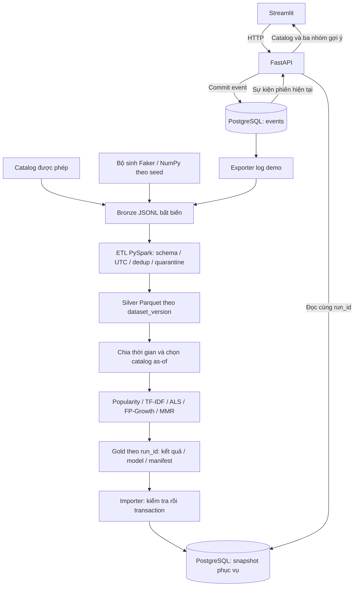
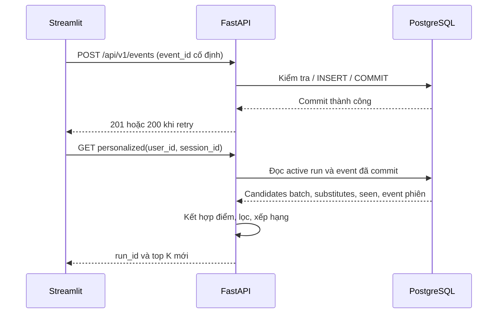

# Kiến trúc hệ thống gợi ý sản phẩm

[Trang chủ repo](../README.md) · [Tech Stack](TECH_STACK.md) · [Quy ước đồng nhất](CONVENTIONS.md) · [Vận hành](README.md) · [Hợp đồng v1](DATA_CONTRACTS.md) · [Thực nghiệm](EXPERIMENT_PLAN.md) · [Kế hoạch & Phân công](../PLAN.md) · [Checklist](PROJECT_CHECKLIST.md)

## 1. Mục tiêu và ranh giới

Hệ thống chạy local cho tiểu luận Nhóm 1. Pipeline batch xử lý dữ liệu lớn hơn log demo, tạo model và snapshot có thể tái lập. FastAPI phục vụ kết quả đã tính sẵn và xử lý tín hiệu phiên; Streamlit chỉ gọi API, không truy cập trực tiếp Spark hoặc database. Ba đầu ra bắt buộc là Dành cho bạn, Sản phẩm thay thế và Thường thêm cùng.

T01 đặc tả kiến trúc cho T02–T12 trong [PLAN.md](../PLAN.md). Nhánh ingestion đã có CLI và một luồng Kafka mô phỏng tùy chọn; các migration/API/model tiếp tục theo kế hoạch. V1 không yêu cầu Spark Structured Streaming, cluster phân tán hoặc train lại model khi có click. “Cập nhật theo phiên” là tính lại điểm trong request sau khi event được lưu, còn học dài hạn diễn ra theo batch.

## 2. Thành phần và trách nhiệm

| Thành phần | Trách nhiệm | Không làm trong đường request |
| --- | --- | --- |
| `ingestion/` | Chuẩn hóa catalog từ nguồn cho phép; sinh event có seed, sở thích, phiên và giỏ nhiều sản phẩm. | Không ghi trực tiếp kết quả mô hình vào DB. |
| `streaming/` | Mô phỏng profiles → Kafka product-events → micro-batch Bronze local/MinIO. | Không cập nhật model hoặc snapshot phục vụ. |
| `pipeline/` | ETL, ghi manifest, xuất log demo, kiểm tra và nạp snapshot. | Không được kích hoạt batch chưa đầy đủ. |
| `ranking/` | Tính ứng viên, điểm, MMR, luật giỏ và điểm theo phiên. | Không train ALS/FP-Growth khi API nhận request. |
| `evaluation/` | Chia dữ liệu, tính metric, benchmark và lưu cấu hình phép đo. | Không dùng test để chọn tham số. |
| `api/` | Đọc snapshot, lọc/rank ứng viên, nhận event bất biến, trả status code theo hợp đồng. | Không đọc Parquet hay khởi tạo Spark trong request. |
| `ui/` | Giữ user/session/cart, hiển thị catalog, ghi hành vi và yêu cầu gợi ý mới. | Không suy luận trực tiếp bằng model hoặc ghi thẳng DB. |

Môi trường chuẩn: Python 3.11, JDK 17, PySpark 3.5.7, PostgreSQL 17, FastAPI và Streamlit theo dependency trong `pyproject.toml`. Spark chạy `local[2]` trong kiểm tra nhỏ; cấu hình benchmark được ghi cùng kết quả. `docker-compose.yml` cung cấp PostgreSQL 17, MinIO và Kafka 3.8.0 KRaft một node cho luồng mô phỏng tùy chọn. Profiles nhân khẩu học dùng Faker `vi_VN`; cả bộ sinh batch và producer đều kiểm tra sở thích theo category_id của catalog.

## 3. Data Lake ba lớp trên MinIO S3 Object Storage

Data Lake được lưu trữ tập trung trên **MinIO Object Storage** (chuẩn giao thức Amazon S3, URI `s3a://`, cổng API `9000`, cổng Console `9001`), hỗ trợ cả chế độ phân tán qua mạng LAN/Tailscale lẫn fallback thư mục local `data/`:

### 3.1. Bronze: nguồn gốc và khả năng replay

Bucket `bronze` (`s3a://bronze/products/` và `s3a://bronze/events/`) chứa JSONL UTF-8, một object mỗi dòng. Phân chia theo nguồn và đợt nhập; mỗi đợt có manifest ghi schema version, file, SHA-256, số dòng, seed nếu mô phỏng, nguồn và khoảng thời gian. Tên file khác nhau không thay đổi `event_id` khi xuất lại dữ liệu.

Catalog giữ lịch sử các lần thu thập; `product_id` ổn định theo `<source>:<id_goc>`. Event gồm `view`, `click`, `add_to_cart`; `source` của event chỉ là `synthetic` hoặc `demo`. Bronze là bản ghi nguồn, không ghi đè một đợt đã công bố. File đang ghi ở vị trí tạm; chỉ công bố manifest sau khi đóng file và kiểm tra checksum.

### 3.2. Silver: schema rõ ràng và kiểm tra chất lượng

Silver lưu Parquet tại `s3a://silver/products/<dataset_version>/` và `s3a://silver/events/<dataset_version>/` (hoặc local `data/silver/...`). Các schema, kiểu và nullable nằm trong [DATA_CONTRACTS.md](DATA_CONTRACTS.md). ETL thực hiện:

1. Đọc với schema tường minh; từ chối ID rỗng, thời gian thiếu múi giờ, event type/source ngoài enum và `add_to_cart` thiếu `cart_id`.
2. Chuẩn hóa timestamp UTC và UUID. Đặt `spark.sql.session.timeZone=UTC` cho cả đọc, tổng hợp và ghi.
3. Gộp event trùng ID và payload chuẩn hóa giống nhau. Cùng ID khác payload: đưa toàn bộ nhóm xung đột vào quarantine, không tùy ý chọn một dòng; batch không đủ điều kiện phát hành nếu còn xung đột chưa xử lý.
4. Giữ các phiên bản catalog theo `(product_id, collected_at)`. Hai payload khác nhau cùng khóa phiên bản là xung đột. Khi tạo một snapshot, chọn bản mới nhất trước cutoff cho mỗi sản phẩm.
5. Kiểm tra event tham chiếu catalog, quan hệ user–session–cart và ghi số dòng nhận, trùng, hợp lệ, bị loại theo lý do. Không tự tạo sản phẩm để che lỗi khóa ngoại.
6. Ghi Parquet và báo cáo chất lượng vào vị trí tạm; kiểm tra lại số dòng/checksum rồi công bố phiên bản bất biến.

`dataset_version` nhận diện đầu vào sạch, khác `run_id` nhận diện lần train. Gói chia sẻ tối thiểu gồm products/events Silver, manifest và báo cáo chất lượng. Cơ chế chia sẻ giữ nguyên phiên bản và checksum; lựa chọn dịch vụ lưu trữ thuộc P0-07/P5, chưa được coi là đã triển khai.

### 3.3. Gold: tổng hợp sau chia tập và đầu ra theo batch

Mỗi lần chạy ghi dưới `s3a://gold/<run_id>/` (hoặc local `data/gold/<run_id>/`). Đầu vào được cố định từ lúc bắt đầu. Khi đánh giá offline, **chia thời gian trước khi** cộng trọng số hoặc tạo giỏ. Không dùng một bảng tổng hợp toàn bộ Silver để train rồi mới chia đánh giá.

| Nhóm output | Nội dung |
| --- | --- |
| `interactions/` | Tổng `view=1`, `click=2`, `add_to_cart=4` theo `(user_id, product_id)` trong đúng cửa sổ học. |
| `baskets/` | Mỗi giỏ một tập ID duy nhất, cùng user/session; chỉ lấy sự kiện thêm giỏ hợp lệ trong cửa sổ. |
| `products/` | Catalog as-of cutoff, một dòng mỗi sản phẩm; dùng để phục vụ và lọc ứng viên. |
| `recommendation_items/` | Ứng viên đã xếp hạng theo user, sản phẩm gốc hoặc popularity toàn cục. |
| `seen_products/` | Các cặp user–sản phẩm đã tương tác trước cutoff; dùng lọc cả fallback. |
| `association_rules/` | Luật có antecedent là tập ID, consequent một ID và các chỉ số support/confidence/lift. |
| `models/`, `id_maps/` | Model/vectorizer có thể tải lại và ánh xạ ALS theo run. |
| `evaluation/` | Cấu hình chia tập, metric, thời gian, số mẫu và giới hạn phép đo. |
| `manifest.json` | Liên kết đầu vào, cutoff, seed, commit, cấu hình, danh sách file, số dòng và checksum. |

Snapshot popularity đầu tiên vẫn phải có đủ bốn bảng phục vụ `products`, `recommendation_items`, `seen_products`, `association_rules`. Bảng luật có thể rỗng nhưng phải có schema và được khai báo trong manifest. Không giả tạo luật hoặc gợi ý để đủ số lượng.

## 4. Xây dựng ba nhóm gợi ý

Popularity cộng trọng số trên tập học, sắp `score DESC, product_id ASC`. TF-IDF dùng tên, danh mục và mô tả trong catalog có sẵn ở cutoff; hồ sơ user là tổng vector lịch sử có trọng số. Substitutes chỉ lấy cùng danh mục và loại item gốc. Implicit ALS học trên trọng số, giữ ánh xạ chuỗi → số nguyên 32-bit → chuỗi theo run; user/item chưa có factor đi qua fallback. Giới hạn ID của ALS dựa trên [tài liệu Spark 3.5.7](https://spark.apache.org/docs/3.5.7/ml-collaborative-filtering.html).

MMR nhận tối đa 200 ứng viên trước khi chọn top K, chuẩn hóa relevance và dùng cosine để phạt trùng nội dung. Không mặc định khẳng định MMR tăng đa dạng trên mọi dữ liệu; [kế hoạch thực nghiệm](EXPERIMENT_PLAN.md) đo cả chất lượng và độ đa dạng.

FP-Growth học trên các giỏ train, mỗi item xuất hiện một lần trong giỏ. API chọn luật có `antecedent_ids` là tập con của giỏ gửi lên, khử trùng consequent, loại item đã có, xếp confidence rồi lift rồi product ID. Thông số thuật toán và ý nghĩa luật theo [Spark FP-Growth 3.5.7](https://spark.apache.org/docs/3.5.7/ml-frequent-pattern-mining.html). Quy tắc tương thích chỉ áp dụng cho các cặp thuộc danh sách quy tắc đã định nghĩa; thiếu thông số cần thiết thì không trả cặp đó. V1 không suy ra tương thích từ tên sản phẩm.

## 5. Chuyển snapshot nguyên tử sang PostgreSQL

### 5.1. Phiên bản catalog và trạng thái phục vụ

Cả catalog và kết quả được lưu theo `run_id`. `products` có khóa `(run_id, product_id)`, nhờ đó rollback khôi phục đúng cả metadata lẫn gợi ý. `serving_state` có đúng một dòng `singleton_id=1`; `active_run_id` nullable trước lần phát hành đầu. `batch_runs.status` nhận `loading`, `ready`, `failed`; trạng thái đang active được xác định bằng con trỏ, không phải một enum riêng.

Event demo độc lập với snapshot. DB lưu thêm `catalog_run_id` để tham chiếu phiên bản sản phẩm lúc nhận event, và `received_at` do server cấp. Hai trường này không thuộc payload Bronze/API. Giữ catalog của run cũ khi vẫn còn event tham chiếu; không cascade xóa log khi đổi snapshot.

### 5.2. Quy trình import và kích hoạt

1. Kiểm tra file Gold ngoài transaction: đủ bảng, cùng `run_id`, checksum đúng, schema đúng, khóa/rank không trùng, điểm hữu hạn, ID hợp lệ và tập antecedent chuẩn hóa.
2. Ghi hoặc xác nhận metadata run ở trạng thái `loading`. Cùng `run_id` và cùng fingerprint được retry; cùng ID khác nội dung là lỗi, không ghi đè.
3. Bắt đầu transaction nạp. Khóa dòng singleton bằng `SELECT active_run_id FROM serving_state WHERE singleton_id = 1 FOR UPDATE`. Kiểm tra lại status/fingerprint của run sau khi có khóa; run ready cùng fingerprint là no-op. Hai importer phải chờ nhau, kể cả lần phát hành đầu vì dòng singleton đã được migration tạo.
4. Đối chiếu active run với giá trị mà importer đã đọc trước khi bắt đầu công việc. Nếu đã đổi bởi importer khác, hủy lần kích hoạt này để người vận hành kiểm tra; không để batch hoàn tất muộn tự ghi đè batch vừa phát hành.
5. Nạp catalog và toàn bộ bảng con cho run, kiểm tra lại số dòng và ràng buộc. Cập nhật `batch_runs.status='ready'`, `activated_at` và `serving_state.active_run_id` trong cùng transaction rồi commit.
6. Nếu bất kỳ bước nào lỗi, rollback toàn bộ dữ liệu vừa nạp và con trỏ. Sau rollback, dùng transaction riêng ghi `failed` và lý do chỉ khi run vẫn loading với cùng fingerprint; không ghi đè trạng thái ready do importer khác đã hoàn tất. Snapshot cũ tiếp tục được đọc.

Import lại run `ready` với cùng fingerprint là no-op và không tự kích hoạt một run cũ. Rollback là thao tác kích hoạt có chủ đích một run `ready` còn đủ dữ liệu, kiểm tra con trỏ hiện tại và cập nhật dưới cùng khóa singleton. Không cần train lại để rollback.

### 5.3. Tính nhất quán trong request

API mở transaction chỉ đọc `REPEATABLE READ`, đọc `active_run_id` một lần rồi truyền run đó vào mọi truy vấn catalog, candidates, seen và rules của request. Nếu không có active run, API dữ liệu trả `503`; `/health` vẫn là liveness `200`. Không đọc lại con trỏ giữa các truy vấn. PostgreSQL giữ snapshot ổn định cho transaction ở mức này; `READ COMMITTED` có thể thấy hai trạng thái khác nhau qua hai câu SELECT. Cơ sở: [Transaction Isolation PostgreSQL 17](https://www.postgresql.org/docs/17/transaction-iso.html).

Khóa dòng tuần tự hóa các lần đổi con trỏ theo [Explicit Locking PostgreSQL 17](https://www.postgresql.org/docs/17/explicit-locking.html). Reader không khóa singleton. Các response gợi ý ghi rõ `run_id`; UI có thể so sánh batch/session cùng run. Nếu run đổi giữa hai HTTP request, UI tải lại catalog và gợi ý thay vì ghép metadata cũ với danh sách mới.

## 6. Đường phục vụ và phản hồi theo phiên

### 6.1. Ghi nhận sự kiện đúng một lần theo ID

UI tạo `event_id` trước khi gửi, giữ nguyên khi retry; rerun Streamlit không tạo event mới nếu chưa có thao tác mới. FastAPI validate schema, kiểm tra quyền sở hữu logic của session/cart theo user, kiểm tra sản phẩm trong catalog active, ghi vào `events` rồi mới trả `201`. Payload tương đương cho ID đã tồn tại trả `200`, payload khác trả `409`, kể cả hai request đồng thời. Chi tiết thứ tự xử lý ở [hợp đồng API](DATA_CONTRACTS.md).

UI giữ `user_id`, `session_id` ổn định; một giỏ gắn với một user và một session, `cart_id` mới khi bắt đầu giỏ hoặc phiên mới. Dữ liệu là ID giả danh trong demo, không có tài khoản đăng nhập hay bảng users trong v1.

### 6.2. Cửa sổ, ứng viên và điểm phiên

`GET /api/v1/recommendations/personalized` không có `session_id` dùng batch. Có `session_id` thì đọc tối đa 20 event mới nhất của đúng `(user_id, session_id)` trong 30 phút trước thời điểm request; chỉ dùng event đã commit và có `event_at <= request_time`. Event đến trễ được chấp nhận, nhưng ngoài cửa sổ thì không ảnh hưởng điểm phiên.

Tín hiệu mỗi event bằng trọng số hành vi nhân `2^(-age_minutes/10)`. Lấy ứng viên từ danh sách substitutes đã tính sẵn, hợp với personalized chính; user không có personalized chính dùng popularity thay nguồn batch. Chuẩn hóa điểm batch và session riêng về `[0,1]`, kết hợp `0.7 × batch + 0.3 × session`, chọn tối đa 200 theo điểm rồi ID. Popularity bù thiếu được thêm sau, không đưa chung thang điểm ALS vào chuẩn hóa. Các hằng số là mặc định v1; nhánh chỉ batch/chỉ phiên trong thực nghiệm là phép so sánh được ghi riêng, không thay đổi ngầm cấu hình phục vụ.

Khử trùng và lọc catalog, `seen_products` của run cùng các sản phẩm user đã tương tác trong cửa sổ phiên trước khi lấy `limit`. Tín hiệu phiên rỗng hoặc không sinh được ứng viên dùng chính sách batch/fallback. Request batch thuần chỉ dùng bộ lọc seen của snapshot để có thể so sánh lặp lại. Điểm session và các trường hợp fallback được quy định trong [DATA_CONTRACTS.md](DATA_CONTRACTS.md).

### 6.3. Trình tự cập nhật

V1 không cache response theo phiên. Nếu thêm cache sau này, cache key phải chứa run, user, session và phiên bản lịch sử event; event commit phải làm cache cũ mất hiệu lực. Độ trễ được đo cả từ POST đến GET và từ thao tác UI đến lúc danh sách hiển thị, không chỉ thời gian suy luận.

## 7. Đưa log demo trở lại batch

Exporter đọc `source='demo'` trong một transaction nhất quán, ghi JSONL chuẩn v1 ra file tạm rồi rename sau khi đóng và kiểm tra; manifest công bố sau cùng. V1 dùng **quét lại đầy đủ** các event đã commit nhìn thấy ở thời điểm xuất, với `received_at` làm mốc chẩn đoán. Không tiến checkpoint chỉ bằng `event_at` hoặc số sequence lớn nhất: event đến trễ hoặc transaction commit đảo thứ tự có thể bị bỏ sót.

Lần xuất sau quét lại sẽ bao phủ các event commit muộn. ETL khử trùng theo `event_id`, nên cơ chế là at-least-once ở file, duy nhất theo ID ở Silver. Không xóa event DB trước khi xác minh bản lưu Data Lake chứa ID và payload tương ứng. Chỉ bổ sung xuất tăng dần khi đã có thiết kế watermark an toàn và test commit đảo thứ tự.

## 8. Tái lập, lỗi và nghiệm thu

| Tình huống | Hành vi bắt buộc |
| --- | --- |
| File Bronze/Silver/Gold chưa ghi xong | Không công bố manifest, không kích hoạt bản dở dang. |
| Gold thiếu bảng hoặc sai checksum | Importer từ chối; active run giữ nguyên. |
| API chưa có snapshot hoặc DB không đọc được | API dữ liệu trả `503`; không trả kết quả từ run chưa sẵn sàng. |
| User mới hoặc ALS thiếu factor | Popularity, lọc seen; đủ bao nhiêu trả bấy nhiêu. |
| Sản phẩm nguồn không còn trong catalog run | Không trả sản phẩm đó; lịch sử cũ vẫn giữ để replay. |
| Giỏ rỗng hoặc không có luật đủ điều kiện | `200`, `items=[]`; không thay bằng gợi ý thay thế. |
| Cùng event được gửi/xuất nhiều lần | Một event logic theo ID, conflict được phát hiện. |
| Hai phiên cùng user hoạt động | Tín hiệu phiên tách theo cả user và session. |

Mỗi run ghi dataset version, commit, seed, cutoff, cấu hình Spark/model, phiên bản môi trường và số dòng. Nghiệm thu gồm fixture offline, rollback snapshot lỗi, retry/concurrency event, tách phiên, chống rò rỉ và luồng nhỏ UI → event → Bronze → batch → API. Chi tiết phép đo ở [EXPERIMENT_PLAN.md](EXPERIMENT_PLAN.md); trạng thái kiểm chứng nằm trong [PROJECT_CHECKLIST.md](PROJECT_CHECKLIST.md).
