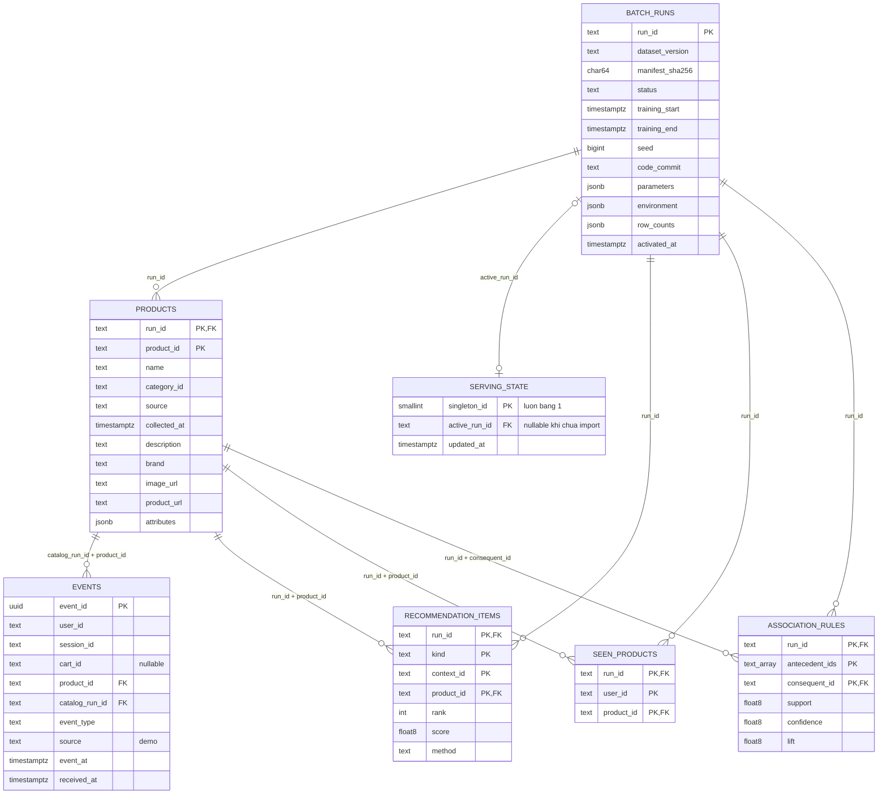

# PostgreSQL phục vụ snapshot và event demo

ERD theo [migration thực tế](../src/recommender/api/migrations/001_initial_schema.sql). Bảy bảng nghiệp vụ cộng bảng kỹ thuật `schema_migrations`. Catalog được phiên bản hóa; product ID có thể xuất hiện trong nhiều run.

`recommendation_items` còn UNIQUE `(run_id, kind, context_id, rank)`. Mọi score hữu hạn. Antecedent được sắp tăng, không trùng, không null; importer kiểm tra từng ID thuộc catalog. Context substitute phải thuộc cùng catalog/category. `events` tham chiếu catalog của lúc nhận; retry event cũ vẫn hợp lệ sau đổi snapshot.

Importer khóa singleton, nạp bốn bảng và đổi con trỏ cùng transaction. API đọc REPEATABLE READ; event ghi READ COMMITTED với advisory lock UUID rồi session/cart theo thứ tự cố định. API không sửa payload đã tồn tại. Chưa có chính sách xóa snapshot/log tự động; FK giữ catalog đang được tham chiếu.

Raw click số lượng lớn ở Kafka → Bronze MinIO, không nhập toàn bộ vào PostgreSQL. PostgreSQL chứa snapshot phục vụ và event demo tương tác website. [Kiến trúc đầy đủ](ARCHITECTURE.md) · [Chạy demo](DEMO.md).
