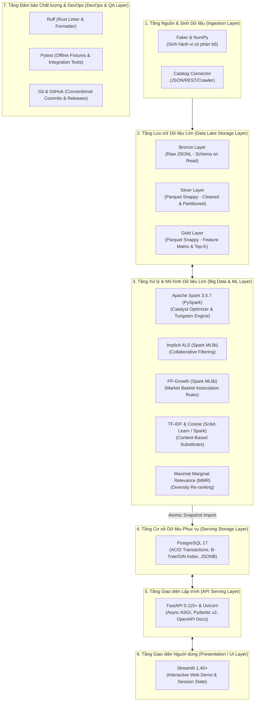

# Đặc tả và Đánh giá Công nghệ Hệ thống (TECH_STACK.md)
*Hệ thống Gợi ý Sản phẩm dựa trên Hành vi Người dùng — Nhóm 1 (Nguyễn Đức Thành & Phan Văn Pháp)*

---

## 1. Sơ đồ Tổng quan Tech Stack theo Tầng Kiến trúc

Dự án áp dụng kiến trúc phân tầng chuẩn của một hệ thống dữ liệu lớn phục vụ thực tế (Big Data & Machine Learning Serving System), phân tách rõ ràng giữa **Lõi Xử lý Batch Phân tán (Offline Pipeline)** và **Tầng Phục vụ Thời gian thực (Online Serving & UI)**:



---

## 2. Chi tiết Từng Công nghệ, Lý do Lựa chọn & So sánh Đối chiếu

---

### 2.1. Ngôn ngữ Lập trình: **Python 3.11**

#### Vai trò trong hệ thống
Ngôn ngữ chủ đạo triển khai toàn bộ pipeline dữ liệu, thuật toán machine learning, backend REST API và giao diện web demo.

#### Lý do lựa chọn
1. **Hệ sinh thái Data Science & AI mạnh nhất thế giới**: Tương thích hoàn hảo với PySpark 3.5, Scikit-learn, NumPy, FastAPI, Streamlit.
2. **Cải tiến vượt bậc về hiệu năng ở bản 3.11**: Bản Python 3.11 trang bị *Specializing Adaptive Interpreter* (PEP 659), giúp tăng tốc độ thực thi CPU từ **10% đến 60%** so với Python 3.10, giảm độ trễ khi xử lý dữ liệu và serving API.
3. **Cú pháp rõ ràng, Type Hinting hiện đại**: Hỗ trợ type hinting chặt chẽ (`typing`), kết hợp hoàn hảo với Pydantic v2 để tự động kiểm tra kiểu dữ liệu đầu vào/ra.

#### So sánh với các công cụ cùng chức năng

| Ngôn ngữ | Ưu điểm | Nhược điểm đối với dự án này | Kết luận đánh giá |
| :--- | :--- | :--- | :--- |
| **Python 3.11 (Được chọn)** | Hệ sinh thái AI/Data vô địch, viết nhanh, tích hợp mượt từ Spark tới Web API và UI. | Hiệu năng tính toán đơn luồng thuần CPU kém hơn ngôn ngữ biên dịch. | **Lựa chọn tối ưu nhất** cho đồ án kết hợp Data Lake, Machine Learning và Web App. |
| **Scala** | Native runtime của Apache Spark, hiệu năng xử lý Spark RDD cao hơn Python một phần nhỏ. | Hệ sinh thái phục vụ web/demo rất nghèo nàn; cú pháp phức tạp, chi phí học tập và phát triển cao cho nhóm 2 người. | Không chọn do làm chậm tiến độ làm API và UI demo. |
| **Java (JDK 17)** | Nền tảng JVM chạy Spark, đa luồng native mạnh, hệ sinh thái backend doanh nghiệp lớn (Spring Boot). | Viết code dài dòng (boilerplate code nhiều), thiếu thư viện tương tác nhanh cho Data Science và demo trực quan. | Chỉ dùng làm JVM Runtime chạy ngầm cho Spark. |
| **Golang** | Biên dịch nhị phân nhanh, tiêu tốn ít RAM, xử lý concurrency cực tốt cho API. | Không có hệ sinh thái Big Data/ML native mạnh; không có thư viện ALS/FP-Growth chuẩn như Spark MLlib. | Không chọn. |

---

### 2.2. Lõi Xử lý Dữ liệu lớn & Khai phá Dữ liệu: **Apache Spark 3.5.7 (PySpark)**

#### Vai trò trong hệ thống
Thực hiện quá trình ETL dữ liệu ba lớp Data Lake (Bronze $\rightarrow$ Silver $\rightarrow$ Gold), tính toán ma trận tương tác có trọng số, huấn luyện mô hình Implicit ALS và khai phá luật giỏ hàng FP-Growth.

#### Lý do lựa chọn
1. **Chuẩn mực công nghiệp xử lý dữ liệu lớn (In-Memory Computing)**: Tối ưu hóa bộ nhớ RAM với cơ chế Lazy Evaluation, bộ tối ưu hóa truy vấn Catalyst Optimizer và định dạng bộ nhớ nhị phân Tungsten.
2. **Thuật toán Machine Learning phân tán tích hợp sẵn (Spark MLlib)**: Cung cấp sẵn thuật toán **Implicit ALS** (Collaborative Filtering xử lý phản hồi ngầm) và **FP-Growth** (khai phá tập phổ biến) được thiết kế tối ưu hóa phân tán.
3. **Tính linh hoạt mở rộng (Scalability)**: Viết mã nguồn chạy trên `local[*]` (máy cá nhân) trong giai đoạn thử nghiệm nhưng sẵn sàng chuyển thẳng lên cụm phân tán (YARN, Kubernetes, Databricks) khi dữ liệu đạt hàng chục triệu bản ghi mà không cần sửa đổi logic code.

#### So sánh với các công cụ cùng chức năng

| Công nghệ | Cơ chế xử lý | Tốc độ | Khả năng mở rộng & Thuật toán | Đánh giá |
| :--- | :--- | :--- | :--- | :--- |
| **Apache Spark (Được chọn)** | In-memory distributed computing, DAG execution. | Rất nhanh (gấp 10–100x Hadoop). | Rất mạnh, có sẵn MLlib (ALS, FP-Growth), scale từ 1 máy lên cụm 1000 máy. | **Lựa chọn cốt lõi bắt buộc** của môn Dữ liệu lớn. |
| **Hadoop MapReduce** | Đọc/ghi disk sau mỗi phase Map và Reduce. | Rất chậm do nghẽn I/O đĩa cứng. | Khó viết các thuật toán lặp (iterative) như ALS; thiếu thư viện ML hiện đại. | Công nghệ thế hệ cũ, không phù hợp cho Recommender System. |
| **Polars / Pandas** | Đơn máy (Single-node), in-memory (Polars dùng Rust multithreading). | Cực nhanh trên 1 máy tính. | Bị giới hạn bởi dung lượng RAM của 1 máy (Out-of-Core failure); không có thuật toán Implicit ALS phân tán. | Không đáp ứng yêu cầu kiến trúc phân tán của môn Dữ liệu lớn. |
| **Dask** | Phân tán trên nền Python thuần. | Khá nhanh. | Hệ sinh thái ML phân tán không chuẩn hóa và kém ổn định hơn Spark MLlib. | Kém phổ biến hơn Spark trong môi trường công nghiệp. |
| **Apache Flink** | Stream processing native (xử lý từng sự kiện). | Cực nhanh cho streaming. | Tập trung vào luồng thời gian thực; xử lý batch và thư viện thuật toán gợi ý không mạnh bằng Spark MLlib. | Không phù hợp cho bài toán batch recommender của đồ án. |

---

### 2.3. Định dạng Lưu trữ Data Lake: **JSON Lines (Bronze) & Apache Parquet (Silver, Gold)**

#### Vai trò trong hệ thống
- **Bronze**: Lưu trữ raw events và raw catalog dưới dạng file JSON Lines (`.jsonl`).
- **Silver & Gold**: Lưu trữ dữ liệu đã làm sạch và các bảng đặc trưng phục vụ dưới dạng Apache Parquet (`.parquet`) nén Snappy.

#### Lý do lựa chọn
1. **Bronze dùng JSONL (Schema-on-Read)**: Mỗi dòng là một JSON object độc lập, không cần đóng mở ngoặc mảng như JSON thông thường; cực kỳ thuận tiện cho việc append sự kiện theo thời gian thực mà không làm hỏng file cũ; dễ kiểm tra, debug trực tiếp bằng mắt thường hoặc CLI.
2. **Silver/Gold dùng Parquet (Columnar Storage)**: 
   - **Nén dung lượng vượt trội**: Nén Snappy giúp giảm từ **70% đến 85%** dung lượng đĩa so với CSV và JSON.
   - **Column Pruning & Predicate Pushdown**: Khi Spark tính toán ma trận tương tác chỉ cần đọc `user_id`, `product_id`, `event_type`, Parquet chỉ tải đúng các cột này lên RAM, bỏ qua toàn bộ các cột khác, giảm thiểu triệt để băng thông đĩa.
   - **Lưu trữ Metadata & Schema nguyên vẹn**: Giữ nguyên kiểu dữ liệu (timestamp, int, double) mà không lo lỗi parse chuỗi ngày tháng như CSV.

#### So sánh với các định dạng lưu trữ khác

| Định dạng | Cấu trúc lưu | Tỷ lệ nén | Tốc độ đọc phân tích (OLAP) | Bảo toàn Schema | Đánh giá |
| :--- | :--- | :--- | :--- | :--- | :--- |
| **JSONL (Chọn cho Bronze)** | Row-based | Thấp | Chậm | Có cấu trúc linh hoạt | **Tốt nhất cho Raw Ingestion** |
| **Parquet (Chọn cho Silver/Gold)** | Columnar | **Rất cao (Snappy)** | **Cực nhanh** | **Tuyệt đối (Strong typing)** | **Chuẩn mực công nghiệp cho Data Lake** |
| **CSV** | Row-based | Rất thấp | Chậm | Kém (mọi thứ là text, dễ lỗi dấu phẩy) | Lạc hậu, không dùng cho Big Data |
| **Apache Avro** | Row-based | Cao | Trung bình | Tốt (Schema JSON) | Tốt cho message bus (Kafka), kém hơn Parquet trong truy vấn phân tích cột |
| **Delta Lake / Iceberg** | Parquet + Transaction Log | Rất cao | Rất nhanh | Có thêm ACID & Time-travel | Quá phức tạp và nặng cấu hình cho phạm vi đồ án local demo |

---

### 2.4. Cơ sở Dữ liệu Phục vụ Gợi ý: **PostgreSQL 17 (với psycopg3)**

#### Vai trò trong hệ thống
Lưu trữ catalog sản phẩm phục vụ, tiếp nhận sự kiện tương tác trực tiếp từ người dùng, lưu trữ snapshot kết quả gợi ý top-K, lịch sử tương tác để lọc trùng, và chuyển đổi snapshot phục vụ nguyên tử (atomic switch).

#### Lý do lựa chọn
1. **Đảm bảo tính ACID và Transaction nguyên tử**: Cho phép nạp toàn bộ dữ liệu của một lần chạy Gold (`recommendation_items`, `seen_products`, `association_rules`) vào DB và cập nhật con trỏ `serving_state` trong **duy nhất 1 transaction**. Nếu có lỗi giữa chừng, toàn bộ thay đổi tự động rollback, website không bao giờ bị trạng thái dữ liệu dở dang hay downtime.
2. **Hỗ trợ kiểu dữ liệu phong phú**:
   - Kiểu `JSONB`: Lưu thuộc tính kỹ thuật linh hoạt của sản phẩm (`attributes`).
   - Kiểu mảng `TEXT[]`: Lưu danh sách các sản phẩm vế trái (`antecedent_ids`) trong luật giỏ hàng, cho phép dùng toán tử tập hợp `@>` (chứa trong) cực nhanh.
   - Kiểu `UUID` và `TIMESTAMPTZ`: Chuẩn hóa định danh sự kiện và thời gian thực UTC.
3. **Chỉ mục (Indexing) mạnh mẽ**: B-Tree composite index trên `(run_id, kind, context_id, rank)` giúp truy vấn danh sách gợi ý top 10 trả về trong thời gian dưới **5 mili-giây**.
4. **Thư viện kết nối `psycopg3`**: Driver hiện đại nhất của PostgreSQL cho Python, hỗ trợ connection pooling và native async/await.

#### So sánh với các cơ sở dữ liệu khác

| Hệ thống DB | Loại | Thế mạnh | Điểm yếu đối với dự án này | Kết luận |
| :--- | :--- | :--- | :--- | :--- |
| **PostgreSQL 17 (Được chọn)** | RDBMS Quan hệ | ACID tuyệt đối, hỗ trợ mảng và JSONB xuất sắc, index mạnh, cực kỳ ổn định. | Tốc độ ghi quy mô hàng trăm nghìn write/s kém hơn NoSQL phân tán. | **Lựa chọn hoàn hảo nhất** cho tầng Serving đảm bảo tính toàn vẹn dữ liệu. |
| **MySQL** | RDBMS Quan hệ | Phổ biến, đọc đơn giản nhanh. | Hỗ trợ kiểu mảng và JSON kém hơn Postgres; kiểm soát ràng buộc Check Constraint và Transaction khắt khe không bằng Postgres. | Thua điểm so với PostgreSQL về độ phong phú kiểu dữ liệu. |
| **MongoDB** | NoSQL Document | Lưu JSON tự nhiên, schema động. | Không có quan hệ khóa ngoại (foreign key); transaction liên collection phức tạp; dễ gây mất toàn vẹn khi snapshot bị lỗi. | Không tối ưu cho bảng snapshot có cấu trúc cố định. |
| **Redis** | In-Memory Key-Value | Tốc độ sub-millisecond (dưới 1ms). | Dữ liệu lưu RAM tốn kém; persistence kém tin cậy hơn RDBMS; không hỗ trợ truy vấn quan hệ hay lọc luật tập con linh hoạt. | Phù hợp làm bộ nhớ đệm phụ (cache), không phù hợp làm DB lưu trữ chính cho đồ án. |
| **Cassandra** | NoSQL Wide-Column | Khả năng scale ghi khổng lồ. | Cài đặt cực nặng, không hỗ trợ transactions, không hỗ trợ join/index linh hoạt; cấu hình vượt quá nhu cầu máy cá nhân. | Không phù hợp. |

---

### 2.5. Cơ chế Thu thập & Lưu trữ Hành vi Người dùng (Clickstream / Event Store)

#### Vai trò trong hệ thống
Tiếp nhận, kiểm tra tính toàn vẹn (idempotency, schema) và lưu trữ mọi hành vi tương tác của người dùng (`view`, `click`, `add_to_cart`) ở cả hai cấp độ: **Thời gian thực tức thì (Online Serving)** và **Lưu trữ phân tích dài hạn (Data Lake)**.

#### Kiến trúc Lưu trữ Hành vi Hai Cấp (Dual-Tier Storage Architecture)
Hệ thống **không bỏ sót bất kỳ hành vi nào** mà phân chia việc lưu trữ làm 2 tầng có vai trò rõ ràng:

```text
Streamlit (Thao tác: View / Click / Add)
     │
     ▼ (HTTP POST /api/v1/events)
FastAPI (Idempotency check: 201 Created / 200 Duplicate / 409 Conflict)
     │
     ▼
[TẦNG 1: ONLINE EVENT STORE] ───► PostgreSQL (Bảng `events` - Immutable Log)
                                       │  • Lưu tức thì (sub-10ms)
                                       │  • Phục vụ gợi ý theo phiên (Session Reranking)
                                       ▼ (Script trích xuất định kỳ / batch trigger)
[TẦNG 2: OFFLINE DATA LAKE]  ───► Data Lake Bronze (`data/bronze/events/*.jsonl`)
                                       │  • Kết hợp cùng Synthetic Events từ Faker
                                       ▼ (PySpark ETL)
                                  Data Lake Silver (`data/silver/events/*.parquet`)
                                       │  • Dùng huấn luyện ALS, Popularity, FP-Growth
```

1. **Tầng 1 — Online Event Store (PostgreSQL bảng `events`)**:
   - **Mục đích**: Ghi nhận ngay tức thì khi người dùng thao tác trên web. Đảm bảo tính **Bất biến (Immutable Append-Only Log)** và **Khử trùng lặp (Idempotency)**: nếu mạng lag khiến người dùng click 2 lần cùng một `event_id`, DB sẽ không bị nhân bản bản ghi.
   - **Tối ưu truy vấn phiên**: Bảng `events` được đánh index trên `(session_id, event_at DESC)` giúp API đọc lại các tương tác gần nhất trong phiên hiện tại chỉ mất **2–3 mili-giây** để lập tức xếp hạng lại (rerank) top-K gợi ý theo thời gian thực mà không cần chạy lại mô hình batch.
2. **Tầng 2 — Offline Data Lake (Bronze JSONL $\rightarrow$ Silver Parquet)**:
   - **Mục đích**: Lưu trữ bền vững toàn bộ lịch sử hành vi tích lũy qua nhiều ngày/tháng để làm dữ liệu huấn luyện cho PySpark.
   - Script `export_events.py` trích xuất các event demo từ PostgreSQL sang file JSONL trong `data/bronze/events/`, kết hợp cùng hàng trăm nghìn sự kiện mô phỏng từ Faker để đưa vào pipeline PySpark ETL nén sang Parquet phục vụ huấn luyện batch.

#### So sánh với các giải pháp lưu trữ hành vi khác

| Giải pháp | Cơ chế hoạt động | Ưu điểm | Nhược điểm đối với dự án này | Kết luận đánh giá |
| :--- | :--- | :--- | :--- | :--- |
| **FastAPI + PostgreSQL Events (Được chọn cho Online) + Data Lake (Offline)** | FastAPI ghi nhận, lưu DB quan hệ có Index và xuất ra Parquet Data Lake. | **Đơn giản, tin cậy, nhẹ RAM, đảm bảo 100% ACID**, chống duplicate tốt, truy vấn phiên tức thì dưới 5ms. | Khi quy mô lên tới >50.000 events/giây cần sharding hoặc partitioning bảng. | **Lựa chọn tối ưu và chuẩn mực nhất** cho hệ thống demo đồ án chạy local. |
| **Apache Kafka** | Distributed Streaming Platform, ghi event log vào các Partition Topic. | Xử lý hàng trăm nghìn event/s, decoupled producer và consumer. | Cực kỳ nặng (cần Zookeeper/KRaft và JVM daemon), tốn thêm **2–4GB RAM**, cài đặt phức tạp trên máy cá nhân, quá cồng kềnh cho phạm vi demo 2 người. | Không chọn do lãng phí tài nguyên máy và tăng rủi ro lỗi runtime khi demo. |
| **Redis Streams** | In-memory message stream trong Redis. | Tốc độ ghi cực nhanh (in-memory). | Lưu trữ trên RAM đắt đỏ, không bền vững lâu dài bằng RDBMS, vẫn cần viết thêm worker để flush dữ liệu ra đĩa. | Thừa thãi khi PostgreSQL local đã đáp ứng độ trễ vài mili-giây. |
| **Ghi thẳng vào file JSON/Log (Direct File Logging)** | Web server ghi nối dòng trực tiếp vào file text trên đĩa. | Nhanh, không cần database. | Không đảm bảo an toàn đa luồng (file lock conflict khi nhiều request ghi đồng thời), không có index để truy vấn nhanh sự kiện theo phiên cho session reranking. | Không an toàn cho môi trường web đa luồng. |

---

### 2.6. Tầng Giao diện Lập trình: **FastAPI & Uvicorn**

#### Vai trò trong hệ thống
Cung cấp cổng giao tiếp RESTful API v1 phục vụ dữ liệu catalog, tiếp nhận sự kiện tương tác từ website và trả về các danh sách gợi ý (Dành cho bạn, Thay thế, Mua kèm).

#### Lý do lựa chọn
1. **Hiệu năng dẫn đầu thế giới Python**: Dựa trên Starlette và Pydantic, chạy trên ASGI server (Uvicorn), hỗ trợ non-blocking I/O bất đồng bộ, tốc độ tương đương NodeJS và Go.
2. **Xác thực Schema tự động (Data Validation)**: Tích hợp sâu với Pydantic v2. Mọi payload gửi lên đều được tự động validate kiểu dữ liệu, bắt lỗi thiếu trường (`cart_id` khi `add_to_cart`) và trả về HTTP `422` tự động mà không cần viết code thủ công.
3. **Tự động sinh tài liệu chuẩn tương tác (Interactive API Docs)**: Tự động tạo Swagger UI tại `/docs` và ReDoc tại `/redoc`, giúp hai thành viên trong nhóm kiểm thử API ngay trên trình duyệt mà không cần cài Postman.

#### So sánh với các framework API khác

| Framework | Kiểu thực thi | Tốc độ | Validation tự động | Tự sinh Swagger UI | Đánh giá |
| :--- | :--- | :--- | :--- | :--- | :--- |
| **FastAPI (Được chọn)** | Bất đồng bộ (ASGI) | **Cực nhanh** | **Tích hợp sẵn (Pydantic v2)** | **Có sẵn (`/docs`)** | **Hiện đại, chuẩn mực nhất cho Python API** |
| **Flask** | Đồng bộ (WSGI) | Trung bình | Không có (phải cài thêm Marshmallow) | Không có sẵn | Công nghệ cũ, tốn nhiều code để dựng validation và docs |
| **Django REST Framework (DRF)** | Đồng bộ / Hybrid | Nặng nề, chậm hơn | Dùng Serializer riêng của Django | Cần cài thêm thư viện | Quá đồ sộ và cồng kềnh, không phù hợp cho microservice |
| **Tornado** | Bất đồng bộ | Nhanh | Kém | Không có sẵn | Cú pháp cũ, cộng đồng hiện tại thua xa FastAPI |

---

### 2.7. Tầng Giao diện Người dùng Demo: **Streamlit**

#### Vai trò trong hệ thống
Website thương mại điện tử demo tương tác trực quan cho phép người dùng lướt xem sản phẩm, click, thêm vào giỏ hàng và quan sát trực tiếp kết quả của 3 khối gợi ý.

#### Lý do lựa chọn
1. **Tối ưu hóa thời gian phát triển (Rapid Prototyping)**: Viết 100% bằng Python, tạo giao diện web hoàn chỉnh với các thành phần hiện đại (card sản phẩm, nút bấm, giỏ hàng, bảng số liệu) chỉ trong vài trăm dòng code.
2. **Quản lý phiên tương tác trực quan (`st.session_state`)**: Duy trì trạng thái người dùng (`user_id`), mã phiên (`session_id`) và giỏ hàng (`cart_id`) ổn định giữa các lượt tải trang; dễ dàng chuyển đổi giữa các tài khoản demo (User có lịch sử tương tác vs User mới cold-start).
3. **Tách biệt hoàn toàn logic (Decoupled Architecture)**: Streamlit chỉ đóng vai trò Client gọi HTTP request sang FastAPI, tuyệt đối không truy cập trực tiếp DB hay Spark, mô phỏng đúng kiến trúc hệ thống phân tán thực tế.

#### So sánh với các giải pháp giao diện khác

| Công nghệ | Thời gian phát triển | Độ tùy biến giao diện | Phù hợp cho đồ án Data/AI | Đánh giá |
| :--- | :--- | :--- | :--- | :--- |
| **Streamlit (Được chọn)** | **Rất nhanh (1–2 ngày)** | Khá tốt, hiện đại | **100% phù hợp** | **Lựa chọn tối ưu nhất để tập trung nguồn lực vào Big Data** |
| **React / Next.js** | Rất lâu (1–2 tuần) | Cực cao | Thừa thãi so với mục tiêu môn học | Tốn quá nhiều thời gian viết Frontend, làm giảm thời gian cho Data/ML |
| **Gradio** | Rất nhanh | Kém, bố cục dạng form/chat | Thích hợp cho GenAI/NLP | Khó dựng giao diện mua sắm phân trang và giỏ hàng phức tạp |
| **Dash (Plotly)** | Trung bình | Tốt cho dashboard | Thích hợp cho biểu đồ BI | Cơ chế callback phức tạp khi quản lý trạng thái mua hàng nhiều bước |

---

### 2.8. Bộ Thuật toán Xếp hạng & Gợi ý (Algorithmic Suite)

Hệ thống kết hợp đa thuật toán có chủ đích nhằm giải quyết toàn diện các bài toán thực tế trong thương mại điện tử:

```text
┌─────────────────────────────────────────────────────────────────────────────┐
│                       3 KHỐI GỢI Ý TRÊN WEBSITE DEMO                        │
├─────────────────────────┬──────────────────────────┬────────────────────────┤
│     Trang chủ           │    Trang chi tiết        │    Trang giỏ hàng      │
│  "DÀNH CHO BẠN"         │ "SẢN PHẨM THAY THẾ"      │ "THƯỜNG THÊM CÙNG"     │
├─────────────────────────┼──────────────────────────┼────────────────────────┤
│ • Implicit ALS          │ • TF-IDF Vectorizer      │ • FP-Growth            │
│ • Popularity Fallback   │ • Cosine Similarity      │ • Association Rules    │
│ • MMR Diversification   │ • Category Constraint    │   (Confidence / Lift)  │
│ • Session Reranking     │                          │                        │
└─────────────────────────┴──────────────────────────┴────────────────────────┘
```

#### 1. Implicit ALS (Alternating Least Squares) — Trang chủ "Dành cho bạn"
- **Tại sao chọn**: Trong thực tế thương mại điện tử, 99% dữ liệu người dùng là **phản hồi ngầm (implicit feedback)** như lượt xem, click và thêm giỏ hàng, chứ người dùng rất hiếm khi chấm sao rõ ràng (explicit rating 1-5 sao). Thuật toán Implicit ALS (dựa trên nghiên cứu kinh điển của Hu, Koren, Volinsky) chuyển đổi tần suất hành vi thành độ tin cậy $c_{ui} = 1 + \alpha r_{ui}$ để tìm ra vector tiềm ẩn của user và item.
- **So sánh với SVD / Explicit MF**: SVD truyền thống trên thư viện Surprise coi các ô trống là thiếu dữ liệu (missing values) và chỉ học trên điểm rating cụ thể, hoàn toàn không thể chạy được với dữ liệu hành vi xem/click.

#### 2. Popularity Baseline & Cold-Start Fallback — Dự phòng độ phổ biến
- **Tại sao chọn**: Đối với người dùng mới tinh (chưa từng tương tác), thuật toán ALS không có dữ liệu để tính toán (bài toán Cold-Start). Popularity đóng vai trò làm đường chuẩn (baseline) để so sánh hiệu quả của ALS, đồng thời làm cơ chế dự phòng an toàn (fallback) đảm bảo trang chủ không bao giờ bị rỗng.

#### 3. Content-Based TF-IDF & Cosine Similarity — Trang chi tiết "Sản phẩm thay thế"
- **Tại sao chọn**: Khi người dùng đang xem một sản phẩm cụ thể, họ thường có nhu cầu so sánh các sản phẩm tương tự về thông số và công năng trong cùng một danh mục (ví dụ: đang xem bàn phím cơ red switch thì cần gợi ý bàn phím cơ khác cùng tầm giá/tính năng). TF-IDF trích xuất đặc trưng từ tên, danh mục và mô tả sản phẩm, kết hợp khoảng cách Cosine trong phạm vi cùng `category_id` và loại trừ chính sản phẩm đang xem.

#### 4. Khai phá Luật Giỏ hàng FP-Growth — Trang giỏ hàng "Thường thêm cùng"
- **Tại sao chọn**: Gợi ý các sản phẩm bổ trợ (complements) mua kèm dựa trên thói quen mua sắm chung của tập khách hàng (ví dụ: mua bàn phím cơ thì hay mua kèm kê tay hoặc cáp bọc dù). Thuật toán **FP-Growth (Frequent Pattern Growth)** nén toàn bộ tập giỏ hàng vào một cây tiền tố (FP-Tree) và chỉ cần quét dữ liệu đúng 2 lần.
- **So sánh với Apriori**: Apriori cổ điển liên tục quét toàn bộ dữ liệu và sinh hàng triệu tập ứng viên trung gian (candidate generation bottleneck), chạy cực kỳ chậm và thường xuyên tràn bộ nhớ RAM trên tập dữ liệu lớn. FP-Growth nhanh hơn Apriori từ **10x đến 100x**.

#### 5. Tái xếp hạng Đa dạng hóa MMR (Maximal Marginal Relevance)
- **Tại sao chọn**: Mô hình ALS thuần túy thường gặp hiện tượng "bong bóng lọc" (filter bubble) — gợi ý 10 sản phẩm thì cả 10 cái đều cùng một loại hoặc quá giống nhau. Thuật toán MMR cân bằng giữa độ liên quan (Relevance) và độ mới lạ/đa dạng (Diversity) thông qua tham số $\lambda \in [0, 1]$, giúp tăng độ phủ danh mục và trải nghiệm khám phá của người dùng.

---

### 2.9. Bộ Công cụ Đảm bảo Chất lượng & Năng suất (Developer Tooling & QA)

| Công cụ | Phiên bản | Vai trò & Điểm nổi bật | Lý do vượt trội so với giải pháp khác |
| :--- | :--- | :--- | :--- |
| **Ruff** | `>=0.9,<1` | Linter và code formatter toàn diện. | Được viết bằng **Rust**, chạy nhanh hơn Flake8 và Black gấp **30–100 lần**. Thay thế đồng thời flake8, black, isort, autoflake trong 1 file cấu hình duy nhất `pyproject.toml`. |
| **Pytest** | `>=8,<10` | Framework kiểm thử tự động. | Cung cấp hệ thống Fixture mạnh mẽ, cho phép chạy toàn bộ bộ test schema, hợp đồng, mô hình offline trên dữ liệu mẫu mà không cần kết nối DB hay cụm Spark thật. Vượt trội hơn `unittest` tiêu chuẩn về độ ngắn gọn. |
| **Faker & NumPy** | `Faker >=30`, `numpy >=1.26` | Bộ sinh dữ liệu hành vi nhân tạo có kiểm soát. | Cho phép mô phỏng hành vi mua sắm có quy luật (nhóm sở thích, độ lệch phân bố Power-Law, chuỗi sự kiện theo phiên) với seed cố định (`RANDOM_SEED=42`), giúp tái lập kết quả thực nghiệm 100% trên cả 2 máy. |
| **Git & GitHub** | - | Quản lý phiên bản mã nguồn và phân phối dataset. | Quản lý lịch sử commit theo chuẩn Conventional Commits; sử dụng GitHub Releases API để công bố và tải dataset Parquet giữa 2 máy một cách tự động. |

---

## 3. Bảng Tổng hợp Ma trận Đánh giá & Rủi ro Kỹ thuật

| Tiêu chí | Quyết định trong Tech Stack | Phương án dự phòng nếu gặp lỗi (Fallback Plan) |
| :--- | :--- | :--- |
| **Bộ nhớ PySpark trên máy cá nhân** | Chạy `local[2]` với cấu hình heap size `spark.driver.memory=2g`, kiểm soát kích thước phân vùng (partition size). | Nếu máy RAM yếu (dưới 8GB), hạ số lượng sự kiện mô phỏng xuống mức 10.000 events hoặc kích hoạt lưu checkpoint đĩa. |
| **Độ trễ API Serving** | Tận dụng Connection Pool của `psycopg3` và B-Tree Index trên PostgreSQL, trả kết quả snapshot tính sẵn dưới 10ms. | Nếu truy vấn DB bị chậm, có thể cấu hình LRU cache đơn giản ngay trong tiến trình FastAPI (`functools.lru_cache`). |
| **Toàn vẹn dữ liệu khi nạp Snapshot** | Đóng gói toàn bộ bước import vào 1 transaction duy nhất của PostgreSQL, rollback nếu thiếu file. | Giữ nguyên con trỏ `active_run_id` trỏ vào batch cũ, hệ thống tiếp tục phục vụ snapshot cũ bình thường. |
| **Xử lý Cold-Start người dùng** | Khi user mới chưa có lịch sử trong snapshot, API tự động chuyển hướng trả về danh sách Popularity. | Kết hợp thêm các sản phẩm vừa click trong phiên hiện tại (Session signals) để cá nhân hóa ngay lập tức. |

---

## 4. Kết luận

Tech Stack của dự án được lựa chọn dựa trên 3 nguyên tắc bất di bất dịch:
1. **Đúng chuyên môn Dữ liệu lớn**: Sử dụng Apache Spark làm lõi xử lý dữ liệu và thuật toán học máy phân tán.
2. **Kiến trúc phân tầng chuyên nghiệp**: Tách biệt rõ ràng giữa Data Lake (lưu trữ phân tích), PostgreSQL (phục vụ giao dịch), FastAPI (giao diện kết nối) và Streamlit (trình diễn).
3. **Thực tế và khả thi**: Toàn bộ hệ thống có thể khởi chạy, kiểm thử và demo hoàn hảo trên một máy tính cá nhân thông thường (Core i5 / 8GB RAM) mà vẫn sẵn sàng mở rộng quy mô khi cần thiết.

